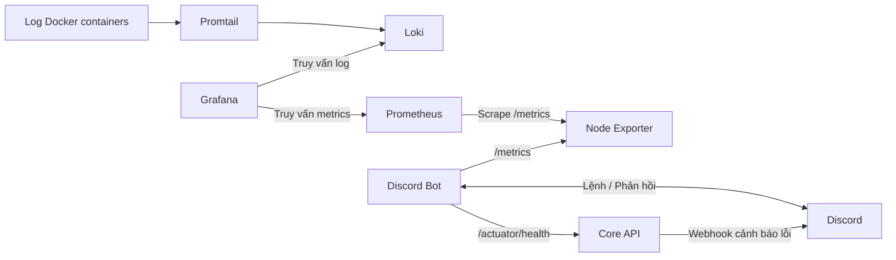

# Architecture Diagram — Mua Makeup

Đối chiếu repository ngày 28/10/2026. Sơ đồ tổng thể có trong `architecture-diagram.mmd`; nội dung Mermaid có thể chỉnh sửa và xuất SVG/PNG bằng công cụ hỗ trợ Mermaid.

## Kiến trúc triển khai gồm máy chủ

Sơ đồ `deployment-architecture.mmd` bổ sung vị trí triển khai: thiết bị người dùng, hosting Vercel, VPS, Docker network, dữ liệu lưu bền vững, các dịch vụ giám sát và pipeline CI/CD.

- Trình duyệt tải giao diện từ hosting rồi gọi API trực tiếp. Ứng dụng native gọi backend từ thiết bị.
- Theo Compose production, core-api, PostgreSQL, Redis, Promtail, Loki, Node Exporter, Prometheus, Grafana và Discord Bot cùng chạy trên VPS, trong mạng Docker `makeup_network`.
- Backend và Grafana lần lượt bind `127.0.0.1:8080` và `127.0.0.1:3000` của host. PostgreSQL và Redis cũng chỉ bind loopback của host; container giao tiếp bằng tên service trong mạng Docker.
- Hai ảnh `backend.conf` người dùng cung cấp ngày 28/10/2026 xác nhận Nginx trên server. Sơ đồ đã cập nhật các tuyến API, WebSocket và Grafana bằng đường liền theo cấu hình trong ảnh.
- Nginx nghe cổng 80: request có host `mua-makeup.duckdns.org` nhận HTTP 301 đến cùng URI qua HTTPS; nhánh fallback trả 404. Cổng 443 kết thúc TLS với chứng chỉ Let's Encrypt được Certbot quản lý.
- `location /` chuyển tiếp đến `http://127.0.0.1:8080`. `location /ws-makeup` chuyển tiếp đến `http://127.0.0.1:8080/ws-makeup`, dùng HTTP/1.1 và các header Upgrade/Connection; read/send timeout là 86400 giây.
- `location /grafana/` có Nginx Basic Auth, sử dụng file `/etc/nginx/.grafana_passwd`, chuyển tiếp đến `http://127.0.0.1:3000` và hỗ trợ Upgrade. Basic Auth là bước xử lý trong Nginx, không phải một container riêng.
- Nginx giới hạn request body ở 50 MB, truyền các header Host, X-Real-IP, X-Forwarded-For, X-Forwarded-Proto và trả 444 cho URL khớp regex chặn. Phần cuối regex bị cắt trong ảnh nên không chép lại toàn bộ rule.
- Vercel là hosting có cấu hình trong cả hai frontend. Sơ đồ không xác nhận deployment đang hoạt động hoặc cơ chế tự động deploy frontend.
- GitHub Actions build backend, push image lên Docker Hub, SSH vào VPS rồi cập nhật stack bằng Docker Compose. Các service có build context, gồm Discord Bot, được build trên VPS theo lệnh `compose up --build`.
- Named volumes giữ dữ liệu qua việc thay container; chúng không tự đại diện cho một hệ thống backup.

Nguồn bổ sung: `.github/workflows/deploy-backend.yml`, `code/frontend/vercel.json`, `code/app/vercel.json`, `code/app/src/services/api.ts`, `docker/promtail/promtail-config.yml` và hai ảnh cấu hình Nginx `backend.conf` do người dùng cung cấp. Đây là đối chiếu cấu hình, chưa kiểm thử kết nối trực tiếp trên server.

## Mô tả dùng trong báo cáo

Hệ thống Mua Makeup sử dụng kiến trúc client–server nhiều lớp. Lớp giao diện gồm ứng dụng Expo/React Native phục vụ khách hàng và thợ trang điểm, cùng web React/Vite phục vụ quản trị viên và studio. Hai ứng dụng giao tiếp với backend Spring Boot qua REST API và WebSocket STOMP. Backend được phân chia theo module nghiệp vụ và triển khai trong một ứng dụng thống nhất. PostgreSQL/PostGIS lưu trữ dữ liệu nghiệp vụ và không gian; Redis phục vụ quản lý token, vị trí GEO, dữ liệu có thời hạn và khóa phân tán. Các dịch vụ bên ngoài cung cấp thanh toán, bản đồ, lưu trữ ảnh, AI, email và thông báo đẩy.

## Cách đọc sơ đồ

- Các module trong khung backend chạy trong cùng ứng dụng `core-api`, dùng chung dữ liệu.
- Tám schema là phân vùng logic trong PostgreSQL.
- REST xử lý yêu cầu nghiệp vụ; WebSocket truyền cập nhật trạng thái và vị trí theo thời gian thực.
- Callback/IPN từ cổng thanh toán quay về backend để xác minh và cập nhật giao dịch.
- Scheduler và listener chạy trong backend. Một số service cũng gửi thông báo trực tiếp; sơ đồ gộp các luồng này để dễ đọc.
- HTTPS/WSS từ client kết thúc TLS tại Nginx; Nginx chuyển tiếp HTTP/WS đến backend qua loopback của VPS theo ảnh cấu hình. Certbot là công cụ quản lý chứng chỉ, không nằm trên đường xử lý từng request.

## Sơ đồ giám sát vận hành bổ sung

Các thành phần vận hành được khai báo trong `docker-compose.prod.yml`. Prometheus hiện cấu hình scrape Node Exporter. Sơ đồ phản ánh cấu hình trong repository, chưa xác minh trạng thái triển khai thực tế.

## Nguồn đối chiếu

- `code/app/package.json`, `code/frontend/package.json`: ứng dụng giao diện.
- `code/backend/core-api/build.gradle`: Java, Spring Boot, JPA, Redis, Flyway và các thư viện tích hợp.
- `code/backend/core-api/src/main/java/com/makeup/platform/config/WebSocketConfig.java`: endpoint STOMP và simple broker.
- `code/backend/core-api/src/main/java/com/makeup/platform/service/`: module nghiệp vụ và tích hợp.
- `docker-compose.prod.yml`: backend, dữ liệu và công cụ vận hành.
- `docker/prometheus/prometheus.yml`, `code/discord-bot/src/index.js`: các luồng giám sát.
- `system-architecture.md`: phân tích chi tiết kiến trúc, module và triển khai.
