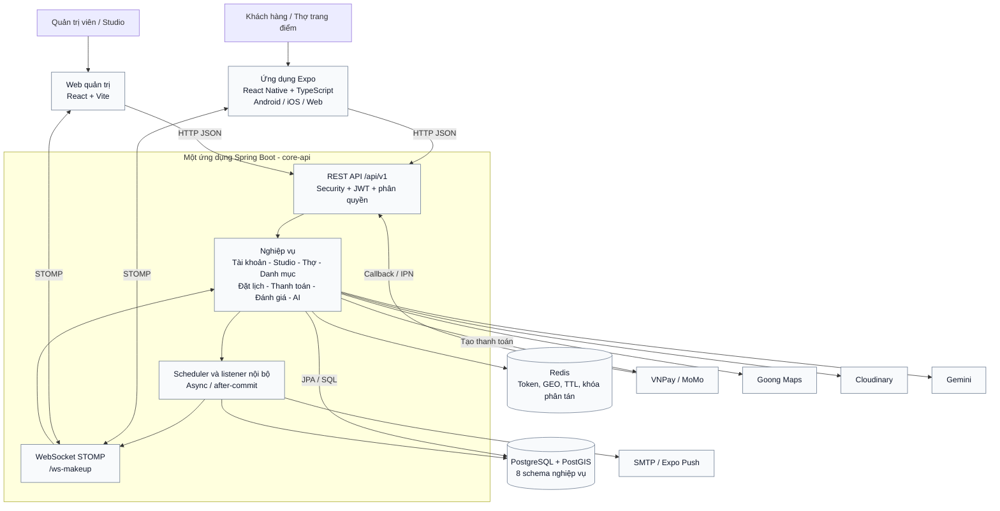
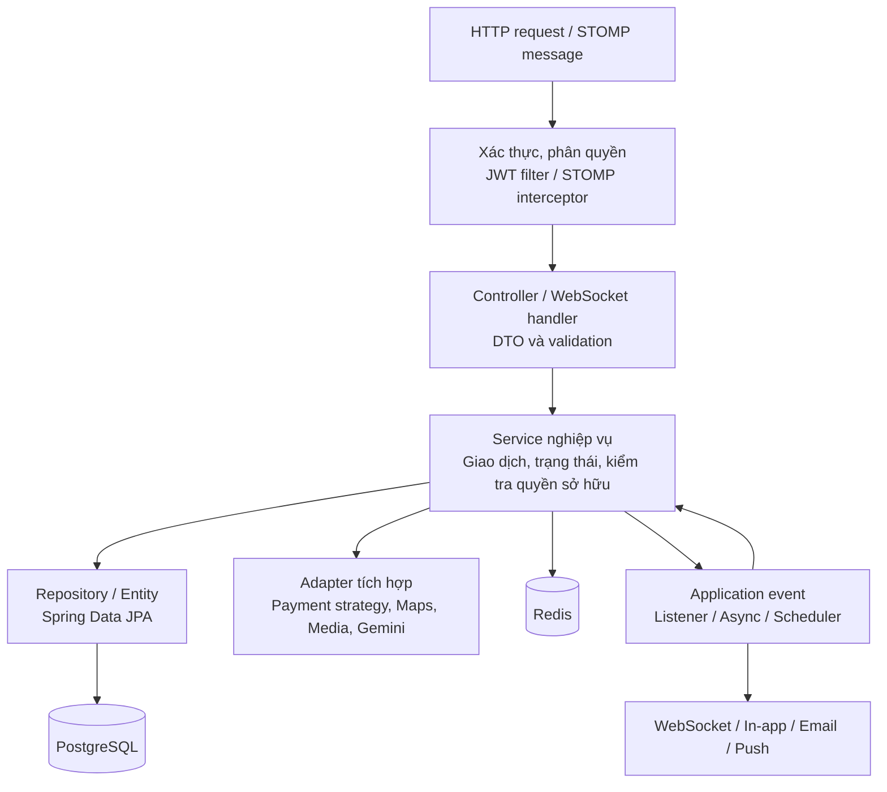
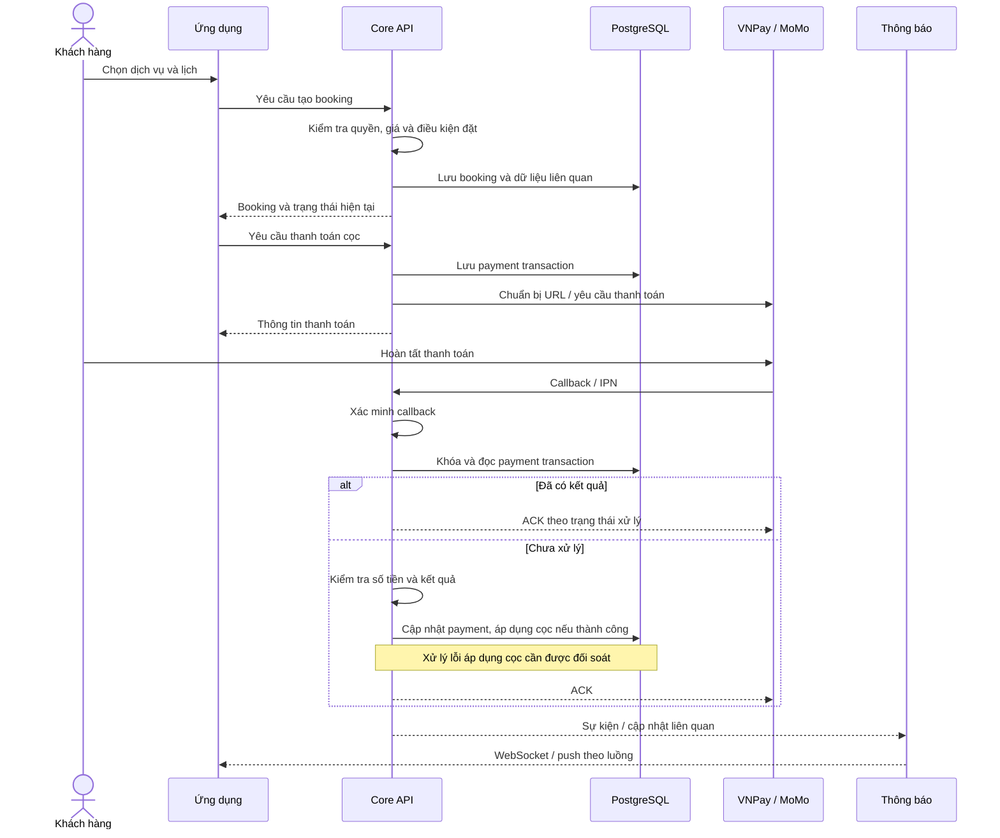
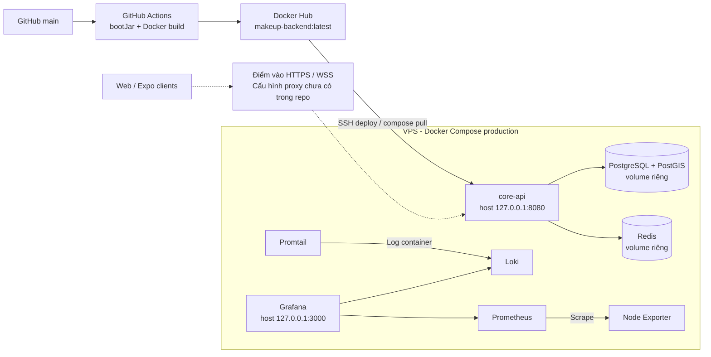

# Thiết kế và phân tích kiến trúc Mua Makeup

Ngày đối chiếu mã nguồn: 27/10/2026. Phạm vi: web quản trị, ứng dụng Expo, backend và cấu hình triển khai trong repository. Đây là phân tích tĩnh; chưa xác minh máy chủ production hay chạy kiểm thử tải.

## 1. Kết luận kiến trúc

Mua Makeup là hệ thống client–server nhiều lớp: hai ứng dụng giao diện gọi chung một backend Spring Boot. Backend tổ chức theo các nhóm nghiệp vụ, triển khai thành một ứng dụng/JAR, dùng chung PostgreSQL và Redis.

Cách mô tả phù hợp trong báo cáo: **kiến trúc monolith phân module nghiệp vụ, tổ chức theo lớp (layered architecture), kết hợp REST, WebSocket và sự kiện nội bộ**.

Có đặc điểm của modular monolith, nhưng chưa nên khẳng định các module được cô lập nghiêm ngặt: service có thể truy cập repository thuộc nhiều nhóm, database có FK liên schema và không thấy cơ chế cưỡng chế ranh giới module trong build. Tám schema là cách phân vùng dữ liệu logic, không phải tám microservice hoặc tám database độc lập.

## 2. Sơ đồ tổng thể

Đường liền thể hiện giao tiếp có trong mã nguồn. Các hộp trong nhóm backend là thành phần của cùng một ứng dụng, không phải các service triển khai độc lập.

### Vai trò các thành phần

| Thành phần | Trách nhiệm và bằng chứng |
|---|---|
| Web React | Giao diện quản trị/Studio; Axios gọi API, Zustand quản lý trạng thái, STOMP nhận cập nhật. Xem package và API client trong `code/frontend`. |
| Expo | Giao diện khách hàng/thợ; định vị, camera, upload, thanh toán và push. Có cấu hình xuất web, không chỉ chạy mobile native. |
| Spring Boot | Java 17, Spring Boot 3.3.4, Spring Security, Validation, JPA, WebSocket, mail, scheduling và async. |
| PostgreSQL/PostGIS | Nguồn dữ liệu bền vững: tài khoản, lịch, booking, thanh toán, ví, đánh giá và lịch sử tọa độ. Flyway quản lý thay đổi schema. |
| Redis | Refresh token, blacklist access token, GEO tìm thợ, heartbeat/TTL, dữ liệu tạm và khóa Redisson/lease điều phối. Redis không chỉ là cache có thể bỏ qua. |
| WebSocket | Spring simple broker trong tiến trình, các destination `/topic`, `/queue`; client gửi đến prefix `/app`. |
| Tích hợp ngoài | Strategy thanh toán VNPay/MoMo; Goong cho bản đồ/khoảng cách; Cloudinary cho media; Gemini cho AI; SMTP/Expo cho thông báo. |

## 3. Kiến trúc bên trong backend

Sơ đồ thể hiện phân lớp khái quát; STOMP có interceptor riêng, không đi qua cùng toàn bộ chuỗi HTTP filter. Scheduler gọi service từ bên trong ứng dụng. Một số service gửi WebSocket trực tiếp, nên hiện trạng chưa buộc mọi thông báo đi qua duy nhất một event pipeline.

| Lớp | Nội dung |
|---|---|
| Tiếp nhận | Controller REST và handler STOMP tiếp nhận yêu cầu, ánh xạ DTO. |
| Bảo vệ | SecurityConfig, JwtAuthenticationFilter, method security và kiểm tra nghiệp vụ/quyền sở hữu trong service. |
| Nghiệp vụ | Service thực thi quy trình đặt lịch, điều phối, tính giá, cọc, quyết toán, xử lý tranh chấp. |
| Truy cập dữ liệu | Repository, entity, transaction và khóa DB; có truy cập liên nhóm nghiệp vụ. |
| Hạ tầng | Redis, Redisson, Cloudinary, Goong, Gemini, SMTP, cổng thanh toán. |
| Xử lý nền | Scheduler cho hết hạn, nhắc lịch, đánh giá; listener async cho nhiều luồng thông báo. |

### Ánh xạ module với dữ liệu

| Module nghiệp vụ | Schema | Vai trò |
|---|---|---|
| Tài khoản và phân quyền | auth_schema | Người dùng, vai trò, quyền, địa chỉ khách hàng |
| Studio và nhân sự | agency_schema | Studio, chi nhánh, nhân viên, ca làm, nghỉ phép, tăng giờ |
| Thợ trang điểm | mua_schema | Hồ sơ, phong cách, lịch và chỉ số uy tín |
| Danh mục và tính giá | catalog_schema | Gói dịch vụ, hạng mục, phong cách, portfolio, phụ phí, giá động |
| Đặt lịch và điều phối | booking_schema | Booking, lịch sử trạng thái, phân công, lời mời nhận ca |
| Định vị | telemetry_schema | GPS, tuyến đường; telemetry_logs phân vùng theo thời gian |
| Thanh toán và ví | wallet_schema | Payment, cọc, hold, ledger, tiền mặt, quyết toán, số dư |
| Tương tác và AI | interaction_schema | Đánh giá, thông báo, phiên chat, tin nhắn và tài liệu tri thức |

Một module có thể dùng nhiều schema: pricing đọc danh mục và dữ liệu vị trí; payment cập nhật cả booking và wallet; agency dispatch phối hợp agency, mua và booking. Các đường phụ thuộc này cần được thể hiện khi bảo vệ thiết kế.

## 4. Luồng nghiệp vụ tiêu biểu

### 4.1 Đặt lịch và thanh toán cọc

Đây là luồng khái quát; booking tức thời, đặt trước và Studio có nhánh trạng thái khác nhau.

Bằng chứng: `PaymentWebhookProcessorImpl` xác minh callback qua strategy, đọc payment bằng khóa, kiểm tra trạng thái để tránh xử lý lặp và đối chiếu số tiền. `BookingDepositServiceImpl` sử dụng Redisson lock và transaction.

Điểm cần phân biệt: gateway báo thu tiền thành công và ứng dụng áp dụng cọc/quyết toán thành công là hai trạng thái khác nhau. Có `application_status` và nhánh `REVIEW_REQUIRED`; không nên mô tả mọi callback SUCCESS đều bảo đảm booking đã hoàn tất chuyển trạng thái. Cần kiểm thử lỗi giao dịch lồng nhau để đánh giá khả năng giữ bằng chứng thanh toán khi ghi sổ thất bại.

### 4.2 Định vị và tìm thợ

1. Thợ bật trực tuyến; backend kiểm tra điều kiện hoạt động và vùng nhận khách.
2. Redis GEO lưu vị trí phục vụ tìm thợ; heartbeat dùng TTL để biểu diễn hoạt động.
3. Mobile gửi GPS qua REST hoặc STOMP; backend kiểm tra tọa độ, độ chính xác và tốc độ.
4. Backend gửi vị trí theo topic tracking; lịch sử được lưu qua TelemetryLogService theo điều kiện trong code.
5. PostgreSQL/PostGIS giữ dữ liệu lịch sử và tuyến đường; Redis phục vụ truy vấn trạng thái nhanh.

Vùng nhận khách và GPS chuyến đi không đồng nhất: implementation có chủ đích không cho GPS chuyến đi làm dịch chuyển GEO index của vùng nhận khách.

### 4.3 Hỗ trợ AI

Ứng dụng gửi câu hỏi → AiSupportService → lấy tài liệu đang hoạt động từ PostgreSQL → tính điểm từ khóa và cosine similarity khi có embedding → dựng context → gọi Gemini → trả câu trả lời và quản lý lịch sử chat.

Hiện tại retrieval tải danh sách tài liệu và tính điểm trong Java. Cột embedding lưu dạng text; chưa có bằng chứng dùng vector database hoặc pgvector index. Vì vậy nên gọi đây là hỗ trợ AI có truy hồi tri thức, không vẽ thêm một vector database độc lập.

## 5. Kiến trúc triển khai theo cấu hình repository

- Compose khai báo một core-api, một PostgreSQL và một Redis, cùng bridge network; dữ liệu có named volumes.
- PostgreSQL và Redis chỉ bind host loopback. Core API và Grafana cũng bind loopback, nên cần thành phần vào hệ thống ở ngoài Compose để truy cập từ Internet.
- Client cấu hình URL HTTPS DuckDNS; repository chưa có cấu hình reverse proxy/TLS để xác nhận dùng Nginx, Caddy hay phương án khác. Nét đứt biểu diễn phần triển khai cần xác minh.
- Web React và Expo web có `vercel.json`; đủ để xác nhận hỗ trợ triển khai Vercel, chưa chứng minh deployment nào đang hoạt động.
- Workflow build backend rồi push Docker Hub, SSH vào VPS và chạy Compose. Hiện bước build dùng `bootJar -x test`.
- Promtail đẩy log sang Loki. Prometheus hiện chỉ có scrape job cho Node Exporter, chưa có scrape job core-api. Không nên mô tả đã thu đủ metrics nghiệp vụ Spring Boot.
- Profile mặc định của ứng dụng là dev; production cần đặt rõ `SPRING_PROFILES_ACTIVE=prod` trong môi trường. Không suy đoán giá trị thực tế trên VPS.
- Redis volume không tự bảo đảm mọi loại dữ liệu đã được cấu hình lưu bền vững đúng mục tiêu; backup/restore và HA cần kiểm chứng riêng.

## 6. Đánh giá kiến trúc

| Điểm phù hợp | Ý nghĩa |
|---|---|
| Một backend cho nhiều client | Tập trung quy tắc tính giá, đặt lịch và thanh toán; giảm khả năng mỗi giao diện hiểu nghiệp vụ khác nhau. |
| Chia nhóm nghiệp vụ và 8 schema | Dễ xác định phạm vi dữ liệu, liên hệ trực tiếp với ERD đã thiết kế. |
| PostgreSQL + Redis | Phân biệt dữ liệu bền vững với trạng thái có TTL, truy vấn GEO và điều phối nhanh. |
| Transaction, khóa và idempotency | Có nền tảng xử lý cạnh tranh khi nhận ca/thanh toán; cần kiểm thử để chứng minh các tình huống cụ thể. |
| Listener after-commit | Một số thông báo được phát sau commit, tránh báo kết quả khi transaction chưa thành công. |
| Payment strategy | Gom khác biệt giữa VNPay/MoMo vào adapter thay vì rải khắp nghiệp vụ. |
| Flyway và Docker | Có cơ sở tái tạo schema và môi trường triển khai. |

### Các giới hạn và ưu tiên cải tiến

Các mục dưới đây là đánh giá/đề xuất từ mã nguồn, không phải thành phần đã triển khai.

| Ưu tiên | Quan sát | Đề xuất cụ thể |
|---|---|---|
| Cao | WebSocketConfig chỉ gắn principal khi CONNECT có JWT hợp lệ; catch lỗi chỉ log, không từ chối tại interceptor này. Chưa thấy kiểm tra quyền SUBSCRIBE trong cấu hình đã đọc. | Từ chối CONNECT không hợp lệ và kiểm tra quyền trên từng topic/booking/agency; kiểm thử truy cập chéo tài khoản. |
| Cao | CORS có wildcard và allowCredentials; websocket cho mọi origin. | Tách danh sách origin theo môi trường và chỉ cho phép domain cần dùng. |
| Cao | CI build bỏ qua test. | Bổ sung test bắt buộc trước build/push; ưu tiên nhận ca đồng thời, callback lặp, lịch chồng và rollback thanh toán. |
| Cao | Event async và simple broker nằm trong tiến trình. | Với thông báo quan trọng, bổ sung outbox bền vững, retry và idempotent consumer; chưa cần tách microservice để làm việc này. |
| Trung bình | Một VPS, một DB/Redis/API theo Compose. | Xác định mục tiêu khôi phục, backup ngoài máy chủ, diễn tập restore và health check trước khi tăng tải. |
| Trung bình | Simple broker là bộ nhớ của từng instance. | Trước khi chạy nhiều API replica, thiết kế phân phối sự kiện và broker dùng chung; kiểm tra scheduler/lease để tránh thực thi lặp. |
| Trung bình | Prometheus mới theo dõi host qua Node Exporter. | Bổ sung metrics API, pool DB, lỗi callback, booking hết hạn, tỷ lệ lỗi và thời gian phản hồi. |
| Trung bình | Retrieval AI tải toàn bộ tài liệu và xếp hạng trong JVM. | Đo số lượng tài liệu/độ trễ; khi cần mới thêm chỉ mục tìm kiếm hoặc vector index. |
| Trung bình | Service truy cập repository liên module. | Quy định quyền sở hữu dữ liệu và service interface; kiểm tra phụ thuộc bằng quy tắc kiến trúc tự động. |

### Hướng thiết kế phát triển tiếp

Giữ monolith phân module ở giai đoạn hiện tại. Trước tiên hoàn thiện ranh giới module, độ tin cậy giao dịch/thông báo, bảo vệ WebSocket và CI. Chỉ cân nhắc tách telemetry, notification hoặc AI thành service riêng khi có số liệu về tải, nhu cầu triển khai độc lập và năng lực vận hành.

Không đưa Kafka, Kubernetes, API Gateway hay microservice vào sơ đồ hiện trạng khi chưa có chúng trong repository. Có thể tạo một sơ đồ mục tiêu riêng sau khi xác định quy mô và yêu cầu phi chức năng.

## 7. Cách trình bày trong báo cáo

Có thể sử dụng đoạn sau:

> Hệ thống Mua Makeup được xây dựng theo kiến trúc client–server nhiều lớp. Lớp giao diện gồm web React và ứng dụng Expo/React Native. Cả hai giao tiếp với backend Spring Boot qua REST API và WebSocket STOMP. Backend được tổ chức theo các module nghiệp vụ như tài khoản, Studio, thợ trang điểm, danh mục, đặt lịch, thanh toán và tương tác, đồng thời triển khai trong một ứng dụng thống nhất. PostgreSQL kết hợp PostGIS lưu dữ liệu bền vững, còn Redis phục vụ token, dữ liệu vị trí, trạng thái tạm thời và điều phối. Hệ thống tích hợp các dịch vụ thanh toán, bản đồ, lưu trữ media, AI và thông báo thông qua các lớp tích hợp chuyên biệt.

Sơ đồ kiến trúc trả lời “thành phần nào chạy ở đâu, giao tiếp bằng gì và chịu trách nhiệm gì”. ERD trả lời “dữ liệu được lưu thế nào và ràng buộc giữa các bảng là gì”. Dùng cả hai, không thay sơ đồ kiến trúc bằng sơ đồ 8 schema.

## 8. Mã nguồn đối chiếu

Các đường dẫn tính từ gốc repository:

| Nội dung | Nguồn |
|---|---|
| Công nghệ backend | `code/backend/core-api/build.gradle` |
| Công nghệ giao diện | `code/frontend/package.json`, `code/app/package.json` |
| API web và mobile | `code/frontend/src/services/api-client.js`, `code/app/src/services/api.ts` |
| Bảo mật HTTP/STOMP | `config/SecurityConfig.java`, `config/WebSocketConfig.java` |
| Token Redis | `service/auth/impl/RedisTokenServiceImpl.java` |
| Điều phối tức thời | `service/customer/impl/CustomerInstantBookingServiceImpl.java`, `service/customer/InstantDispatchLeaseService.java` |
| Payment callback và cọc | `service/payment/impl/PaymentWebhookProcessorImpl.java`, `service/payment/impl/BookingDepositServiceImpl.java` |
| Telemetry | `service/telemetry/impl/TelemetryStreamServiceImpl.java`, `controller/telemetry/WebSocketTelemetryHandler.java` |
| AI retrieval | `service/chatbot/impl/KnowledgeRetrievalServiceImpl.java` |
| Thông báo sau commit | `listener/notification/DomainNotificationEventListener.java` |
| Triển khai | `docker-compose.prod.yml`, `.github/workflows/deploy-backend.yml` |
| Theo dõi hệ thống | `docker/prometheus/prometheus.yml`, `docker/promtail/promtail-config.yml` |

Các đường dẫn Java rút gọn trong bảng bắt đầu tại `code/backend/core-api/src/main/java/com/makeup/platform/`.

