# ĐẶC TẢ YÊU CẦU PHẦN MỀM

**MUA-MAKEUP · Nền tảng đặt dịch vụ trang điểm**

**Mục lục**

1. [Giới thiệu và quy ước](#section-1)
2. [Kiến trúc, công nghệ và tác nhân](#section-2)
3. [Chức năng dùng chung](#section-3)
4. [Đặt lịch và thực hiện dịch vụ](#section-4)
5. [Thanh toán, ví và quyết toán](#section-5)
6. [Vận hành studio và quản trị sàn](#section-6)
7. [Trợ lý AI — AI](#section-7)
8. [Giao diện và trải nghiệm](#section-8)
9. [Dữ liệu, API và yêu cầu chất lượng](#section-9)
10. [Chức năng chưa hoàn thiện và sai khác cần theo dõi](#section-10)
11. [Tiêu chí nghiệm thu và truy vết](#section-11)
12. [Mô hình và đặc tả use case](#section-12)
13. [Sơ đồ kiến trúc, hoạt động và sequence](#section-13)
14. [Mô hình dữ liệu và ERD](#section-14)
15. [Giao diện ngoài, chất lượng và nghiệm thu](#section-15)
16. [Phụ lục truy vết mã nguồn](#section-16)

## 1. Giới thiệu và quy ước

### 1.1. Mục đích

Tài liệu xác định phạm vi, tác nhân, yêu cầu chức năng, quy tắc nghiệp vụ, giao diện, dữ liệu, chất lượng và tiêu chí chấp nhận của MUA-Makeup. Đây là cơ sở thống nhất giữa phát triển và kiểm thử; không thay thế mã nguồn, hợp đồng API chi tiết hoặc biên bản nghiệm thu.

### 1.2. Phạm vi sản phẩm

Nền tảng kết nối khách hàng với thợ trang điểm tự do và studio: khám phá → báo giá → đặt hẹn/cấp tốc → cọc → nhận/phân công → thực hiện → thanh toán → đánh giá/khiếu nại. Studio quản lý nhân sự, kỹ năng, ca trực, nghỉ phép, gói dịch vụ, doanh thu và chất lượng. Quản trị sàn quản lý người dùng, studio, chứng chỉ, danh mục, giá và tranh chấp.

### 1.3. Thuật ngữ

| Thuật ngữ | Ý nghĩa |
| --- | --- |
| MUA | Makeup Artist — thợ trang điểm |
| Agency / Studio | Đơn vị cung cấp dịch vụ, có chủ quản lý và nhân viên |
| Scheduled / Instant | Đặt hẹn trước / đặt cấp tốc |
| Assignment / Dispatch | Phân công nhân viên / điều phối đơn |
| Deposit / Hold | Tiền cọc / khoản tiền đang giữ, chưa được chi trả tự do |
| Settlement / Ledger | Quyết toán nội bộ / bút toán biến động tài chính |
| IPN | Thông báo kết quả thanh toán từ cổng tới backend |
| Ownership | Quyền trên đúng tài nguyên thuộc người dùng hoặc đơn vị |
| Snapshot | Giá trị chụp tại thời điểm nghiệp vụ, dùng đối chiếu về sau |
| BE / WEB / APP | Backend / portal web / ứng dụng Expo |
| FR / NFR / UC / AC / GAP | Chức năng / phi chức năng / ca sử dụng / nghiệm thu / khoảng trống |

## 2. Kiến trúc, công nghệ và tác nhân

### 2.1. Thành phần

| Thành phần | Công nghệ/cấu hình trong nguồn | Trách nhiệm |
| --- | --- | --- |
| Backend | Java **17**, Spring Boot **3.3.4**, Gradle | REST, xác thực, nghiệp vụ, DB, scheduler, WebSocket |
| Web portal | React 18.2, JSX, Vite 5, Router 6, Tailwind 3, Zustand 4, Axios/Zod | Quản trị sàn/studio, landing, đăng nhập/đăng ký/gia nhập |
| App/mobile | Expo **57**, React **19.2.3**, React Native **0.86.3**, TypeScript, Expo Router, Zustand 5 | Khách, freelancer, nhân viên studio; iOS/Android/Expo Web |
| Database | PostgreSQL 16 + PostGIS 3.4, Flyway | Dữ liệu nghiệp vụ/địa lý/lịch sử/tài chính |
| Redis | `redis:7-alpine`, Redisson 3.34.1 | Token/OTP, GEO, heartbeat, khóa, lời mời, offer, chống trùng |
| Realtime | Spring WebSocket/STOMP, Application Events | Thông báo, vị trí và biến động nghiệp vụ |
| Media | Cloudinary | Avatar, logo, chứng chỉ, portfolio, ảnh nghiệm thu/minh chứng |
| Payment | VNPay và MoMo strategy | Checkout, IPN, return, query/sync |
| Maps | Maps proxy/service, Goong và routing/fallback trong service | Geocode, autocomplete, place detail, khoảng cách/ETA |
| Push | Expo Notifications/Expo Push | Token thiết bị, thông báo và mở đối tượng liên quan |
| Email | Spring Mail | OTP đăng nhập quản trị; không còn “loại bỏ 100% email” |
| AI | Gemini client + kho tri thức PostgreSQL | Chat hỗ trợ, retrieval và ngữ cảnh tài khoản |

App dùng React Native components/StyleSheet

Backend là monolith phân tầng `controller → service → repository → entity`, kèm DTO/mapper/config/security/common. REST tiền tố `/api/v1`, port mặc định 8080. WebSocket `/ws-makeup`, application prefix `/app`, simple broker `/topic`, `/queue`, có endpoint thường và SockJS. Event bus/simple broker nội bộ không phải broker bền vững dùng chung nhiều instance.

Compose hiện chạy PostgreSQL/Redis, cổng 5432/6379; backend/web/app chạy riêng. Backend có `application.yml`, `application-dev.yml`, `application-prod.yml`

### 2.2. Vai trò

| Vai trò | Phạm vi hiện tại |
| --- | --- |
| Guest | Landing, danh mục/gói/hồ sơ công khai, maps/nearby và AI công khai theo SecurityConfig |
| `ROLE_CUSTOMER` | APP tìm dịch vụ, địa chỉ, booking/cọc/tracking/thanh toán/hủy/tranh chấp/ví/thông báo/hồ sơ |
| `ROLE_FREELANCE_MUA` | APP hồ sơ/chứng chỉ/gói/showcase/online/nhận ca/thực hiện ca/ví; BE có lịch bận; APP có luồng gia nhập studio |
| `ROLE_AGENCY_STAFF` | APP nhánh thợ/workstation/hồ sơ staff/ca được giao; BE có xác nhận assignment, lịch ca, báo bận, quá giờ theo quyền |
| `ROLE_AGENCY_ADMIN` | WEB `/agency/*`: studio, nhân sự, ca, catalog, dispatch, booking, cấu hình |
| `ROLE_SUPER_ADMIN` | WEB `/admin/*`: dashboard, booking, user, agency, chứng chỉ, taxonomy, pricing/H3, dispute |

Router web hiện chỉ cho AGENCY_ADMIN vào `/agency`, không cho AGENCY_STAFF vào toàn portal. UI guard không thay thế kiểm tra role và ownership ở backend. User ID, MUA ID, staff ID và agency ID không thể hoán đổi.

## 3. Chức năng dùng chung

### 3.1. Tài khoản và hồ sơ

| ID | Chức năng | Hiện trạng |
| --- | --- | --- |
| AUTH-01 | Đăng ký, kiểm tra trùng email/điện thoại, tạo hồ sơ/mã nghiệp vụ theo loại tài khoản | BE, WEB; APP CUSTOMER/FREELANCER_MUA |
| AUTH-02 | Login bằng email/điện thoại và mật khẩu; trả userInfo/roles/permissions/token | BE, WEB, APP |
| AUTH-03 | OTP email 6 số cho super admin/agency admin, phiên 5 phút, gửi lại có giới hạn | BE, WEB modal 2FA; APP không có luồng quản trị tương đương |
| AUTH-04 | Khôi phục phiên, refresh, logout/thu hồi token, xử lý lỗi phiên và điều hướng theo role | BE, WEB, APP |
| AUTH-05 | Đổi mật khẩu, ngôn ngữ vi/en, lấy user hiện tại | BE, WEB; APP có API ngôn ngữ, chưa dịch toàn UI |
| AUTH-06 | Sửa hồ sơ và avatar; khách có API profile riêng | BE, WEB theo modal quản trị, APP |
| AUTH-07 | Đăng ký/cập nhật push token | BE, APP |
| AUTH-08 | Onboarding, lưu đã xem, dọn phiên/listener khi logout | APP |

Backend thiết lập cookie khi login/verify/refresh, đồng thời trả token trong response và hỗ trợ Bearer. Refresh/logout ưu tiên cookie rồi body fallback. Native lưu SecureStore; Expo Web dùng localStorage. Không áp quy định “mọi client chỉ dùng HttpOnly cookie” cho toàn dự án. JWT access mặc định 24 giờ; refresh **7 ngày** theo giá trị cấu hình, không phải comment “30 days”. BCrypt strength 12.

### 3.2. Catalog, portfolio và giá

| ID | Chức năng | Hiện trạng |
| --- | --- | --- |
| CAT-01 | Công khai danh mục/phong cách; admin xem cả ẩn, tạo/sửa/bật/tắt | BE, WEB; APP đọc/chọn/lọc |
| CAT-02 | Gói thuộc freelancer/agency: tạo/sửa/xóa/bật tắt, gói của mình, public list/detail | BE, WEB, APP |
| CAT-03 | Item/bước trong gói: CRUD, giá/thời lượng; add-on cộng giá và thời lượng khi đặt | BE, WEB, APP |
| CAT-04 | Phong cách hồ sơ/gói; gán kỹ năng và khả năng thực hiện gói cho staff | BE, WEB; APP hồ sơ/gói thợ |
| CAT-05 | Portfolio ảnh hồ sơ, upload chứng chỉ; showcase gắn gói với ảnh nhiều góc, mô tả, style, nổi bật, ẩn/hiện, sửa/xóa | BE, APP; WEB quản lý chứng chỉ/nhân sự |
| CAT-06 | CRUD/list/calculate phụ phí; giờ sớm/ngày lễ/ngoài bán kính theo cấu hình | BE, WEB; APP chưa có route CRUD riêng |
| PRICE-01 | Preview hóa đơn gói/add-on/khoảng cách/phụ phí/surge/giảm giá/tổng/cọc; kiểm tra item thuộc gói, gói đang cung cấp | BE, WEB, APP |
| PRICE-02 | Khoảng cách, ETA, bán kính, vị trí cơ sở/vị trí gần nhất/fallback | BE, APP; WEB map picker |
| PRICE-03 | CRUD/bật tắt surge theo khung giờ/ngày/phạm vi, multiplier giảm giá Happy Hour | BE, WEB |
| PRICE-04 | H3 surge cung/cầu; admin xem/bật tắt toàn cục, provider có cờ áp dụng | BE, WEB; APP xem báo giá |

Preview scheduled tính từ gói/add-on, di chuyển, phụ phí, surge; instant có phí khẩn cấp và cập nhật giá khi chốt gói. Snapshot giá booking và kết quả server là cơ sở đối chiếu thanh toán, không dùng công thức dự kiến cũ cho mọi nhánh.

### 3.3. Khám phá, địa chỉ

- **DISC-01:** Trang chủ/Explore tìm thợ/studio/gói, gợi ý/bộ lọc, hồ sơ công khai, giá khởi điểm, style, chứng chỉ, gallery, chi tiết gói và bước thực hiện.
- **DISC-02:** Nearby theo tọa độ/bán kính/category/rating/provider type tùy request; tọa độ công khai có trường làm mờ vị trí.
- **ADDR-01:** Xin quyền GPS, lấy vị trí hiện tại/gần nhất, reverse-geocode; xử lý GPS tắt/từ chối quyền/lỗi.
- **ADDR-02:** Autocomplete, geocode, place detail, chọn map, sửa địa chỉ đích và địa chỉ gần đây.
- **ADDR-03:** CRUD địa chỉ lưu và chọn mặc định; tọa độ dùng tính giá/tracking.

### 3.4. Thông báo và realtime

- **NOTI-01:** List, unread count, đọc, đảo đọc/chưa đọc, đọc hết, xóa một/xóa hết.
- **NOTI-02:** Toast/dropdown/modal, mở booking/hồ sơ liên quan; sound/haptic cho offer trên app.
- **NOTI-03:** STOMP cho offer, booking, dispatch, payment/cash, ví, dispute; reconnect/listener khi khôi phục phiên/foreground.
- **NOTI-04:** Expo push token/gửi push; chạm thông báo mở ca đúng vai trò. Cần quyền thiết bị và cấu hình để nghiệm thu.
- **NOTI-05:** Nhắc lịch 24h/2h, scheduler quét mỗi 15 phút, Redis chống trùng; có scheduler hết hạn tìm thợ/cọc/xác nhận.

Topic gồm user/admin notifications, admin disputes, customer/mua/agency bookings, booking-status, gps-stream, offer, cash và wallet; ID phải theo service tương ứng. REST/DB dùng đối soát khi lỡ sự kiện. Không coi biết topic là đủ quyền truy cập; không cam kết độ trễ <5ms/<100ms chưa đo.
### 3.5. Đánh giá dịch vụ và xếp hạng

| ID | Yêu cầu chức năng | Điều kiện / kết quả |
| --- | --- | --- |
| REV-01 | Khách gửi điểm, nhận xét, ảnh cho đơn của mình | COMPLETED hoặc PAID_OUT; một review/booking; DTO kiểm tra điểm; booking phải có MUA. |
| REV-02 | Công bố review hợp lệ ngay | APPROVED; khách quay lại không tự bị giữ chỉ vì trùng thiết bị. Tổng hợp rating cập nhật trong transaction. |
| REV-03 | Sửa review của mình | Trong 48 giờ từ khi tạo; không khôi phục review đã xóa; không tăng số lượng review. |
| REV-04 | Giới hạn gửi lần đầu | 7 ngày theo mốc service hiện dùng: updatedAt của booking, fallback ngày/giờ đặt rồi createdAt. |
| REV-05 | Đọc review công khai và tổng hợp | Lọc theo provider/điểm/ảnh/category tùy endpoint; không trả review không đủ điều kiện công khai. |
| REV-06 | Studio phản hồi và theo dõi review | Chỉ dữ liệu studio sở hữu; danh sách, bộ lọc, overview/summary, trả lời. |
| REV-07 | Xếp hạng chất lượng staff | Trung bình điểm giảm dần, số review giảm dần; cần ≥5 review để có hạng; đồng hạng 1,1,3; chưa có review trả null, không gán 5 sao. |
| REV-08 | Xếp hạng đóng góp | Số booking hoàn thành phân biệt; có thợ chính/phụ; đồng hạng khi cùng số ca dương, 0 ca không có hạng. |
| REV-09 | Ghi nhận review studio | Một review chung cho booking; mỗi staff có assignment active được ghi nhận một lần; trung bình studio đếm review gốc một lần. Kỳ review theo ngày gửi, kỳ công việc theo ngày hẹn. |

Nguồn: `ReviewServiceImpl`, `ReviewEntity`, `AgencyStaffLeaderboardServiceImpl`, truy vấn leaderboard và migration `V20261030110000`. Attribution dùng assignment active hiện hành, chưa có snapshot lịch sử phân công riêng cho báo cáo.

## 4. Đặt lịch và thực hiện dịch vụ

### 4.1. Hẹn trước — BOOK-SCH

1. Khách chọn freelancer trực tiếp (`FREELANCER_DIRECT`) hoặc studio, gói/add-on, địa chỉ, ngày giờ.
2. Backend kiểm tra gói, provider, thời gian, khả dụng/capacity, lịch bận và thời lượng gồm gói cộng add-on. Scheduled giới hạn tối đa 90 ngày đặt trước; validation thời gian tối thiểu theo DTO/validator.
3. Preview giá rồi tạo booking với snapshot giá/add-on/địa chỉ; khóa lịch/provider và transaction bảo vệ tranh chấp cập nhật.
4. Đơn `PENDING_DEPOSIT`, cọc mặc định **30%**, hạn cọc **15 phút**. Chờ cọc không đồng nghĩa đã độc quyền giữ slot: nguồn hiện tại kiểm tra lại slot lúc xác nhận tiền và có migration giải phóng lịch chưa thanh toán.
5. Cọc được xác nhận: freelancer sang `REQUESTED`, studio sang `PENDING_AGENCY_DISPATCH`. Deadline xác nhận do server tính theo utility/nghiệp vụ; client dùng deadline trả về.
6. Thợ nhận/từ chối; studio gán và xác nhận phân công. Từ chối/hết hạn cập nhật trạng thái, giải phóng lịch và xử lý cọc tương ứng.
7. Khách xem danh sách/chi tiết/lịch sử/thanh toán, nhận nhắc lịch. App có polling/làm mới bổ sung realtime.

BE còn có API ngày có lịch, slot khả dụng, block/unblock lịch bận freelancer/staff. Chưa có route APP quản lý lịch bận độc lập trong kiểm kê hiện tại.

### 4.2. Cấp tốc — BOOK-INS

1. Khách chọn vị trí, radar/danh sách online, gửi instant; có nhánh chọn thợ trực tiếp theo request/app.
2. Backend tạo booking, tìm ứng viên, quản lý offer/lease/TTL trong Redis. Hằng số hiện có: tìm kiếm mặc định **45 giây**, offer cho thợ **20 giây**; nhánh cụ thể có thể điều chỉnh timeout. Nội dung UI “15–30 phút có thợ” không phải SLA đã đo.
3. Thợ nhận popup đếm ngược, âm thanh/rung; nhận hoặc bỏ qua. Backend khóa nhận ca, rút offer không còn hợp lệ.
4. Khách xem thợ ghép, có thể từ chối provider; chọn gói/add-on và xác nhận báo giá trước cọc.
5. Instant cọc 30%, phí khẩn cấp mặc định **150.000 VND**, fallback giá cơ sở **500.000 VND** ở nhánh chưa xác định gói; gói đã chọn dùng giá tương ứng, không bị thay bằng fallback. Chốt gói cập nhật tiền/thời lượng.
6. Đủ điều kiện cọc mới khởi hành; hết hạn/không có thợ/hủy dọn offer/lease, cập nhật các bên.

Nguồn: `CustomerInstantBookingServiceImpl`, `FreelancerBookingServiceImpl`, `InstantDispatchLeaseService`, `InstantBookingExpirationScheduler`, modal radar/offer và `booking/instant-matched/[id]`.

### 4.3. Trạng thái — BOOK-STATE

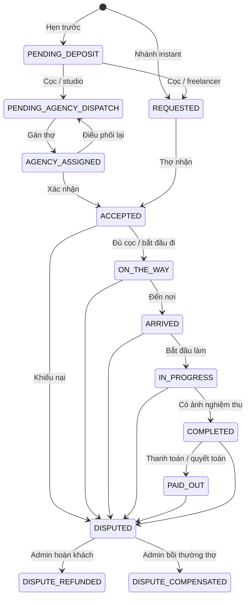

Biểu đồ là luồng chính, không thay thế điều kiện service. Enum đầy đủ: `PENDING_DEPOSIT`, `REQUESTED`, `PENDING_AGENCY_DISPATCH`, `AGENCY_ASSIGNED`, `ACCEPTED`, `ON_THE_WAY`, `ARRIVED`, `IN_PROGRESS`, `COMPLETED`, `PAID_OUT`, `CANCELLED`, `CANCELLED_EXPIRED`, `DISPUTED`, `DISPUTE_REFUNDED`, `DISPUTE_COMPENSATED`.

State machine cho phép hủy tại một số trạng thái trước/đang thực hiện nhưng kiểm tra thêm actor/loại đơn. Scheduler/service chuyên biệt ghi trạng thái hết hạn hoặc kết quả dispute ngoài bảng chuyển chung. `DISPUTED → DISPUTED` bổ sung lời khai/minh chứng. State machine chung còn `DISPUTED → PAID_OUT/CANCELLED/DISPUTE_REFUNDED/DISPUTE_COMPENSATED`; cho phép `PAID_OUT → DISPUTED`, có kiểm tra actor/nghiệp vụ bổ sung. `COMPLETED` chưa đồng nghĩa trả đủ; `PAID_OUT` là quyết toán booking, không phải rút ngân hàng.

Bảng chuyển đầy đủ của `BookingStateMachineServiceImpl.isValidTransition` (chưa áp các điều kiện actor/cọc/ảnh):

| Từ | Đích được phép |
| --- | --- |
| PENDING_DEPOSIT | CANCELLED, REQUESTED, PENDING_AGENCY_DISPATCH |
| REQUESTED | ACCEPTED, PENDING_AGENCY_DISPATCH, CANCELLED |
| PENDING_AGENCY_DISPATCH | AGENCY_ASSIGNED, CANCELLED |
| AGENCY_ASSIGNED | ACCEPTED, PENDING_AGENCY_DISPATCH, CANCELLED |
| ACCEPTED | ON_THE_WAY, CANCELLED, DISPUTED |
| ON_THE_WAY | ARRIVED, CANCELLED, DISPUTED |
| ARRIVED | IN_PROGRESS, CANCELLED, DISPUTED |
| IN_PROGRESS | COMPLETED, CANCELLED, DISPUTED |
| COMPLETED | PAID_OUT, DISPUTED |
| PAID_OUT | DISPUTED |
| DISPUTED | PAID_OUT, CANCELLED, DISPUTE_REFUNDED, DISPUTE_COMPENSATED; đối chất cùng trạng thái qua nhánh riêng |
| Các trạng thái khác | Không chuyển qua switch chung; tác vụ chuyên biệt có quy tắc riêng |

### 4.4. Thực hiện ca và tracking — JOB

- **JOB-01:** Workstation ở trang chủ theo role: thống kê, bán kính, online/offline, ca hôm nay, offer instant/scheduled. `/mua/workstation` hiện chuyển về `/`.
- **JOB-02:** `job-execution/[id]`: thông tin ca/khách/địa chỉ/giá/thu nhập, timeline bắt đầu đi → đến nơi → làm → ảnh → hoàn thành.
- **JOB-03:** Chặn khởi hành khi chưa cọc; bắt buộc ảnh khi COMPLETED; lịch sử lưu actor, trạng thái, thời gian/lý do.
- **JOB-04:** REST `/telemetry/stream` hoặc STOMP `/app/telemetry/location`, Redis vị trí hiện hành, PostGIS log, ETA/mode chuyển động; API lịch sử và nén hành trình.
- **JOB-05:** App lấy/gửi GPS bằng vòng chạy trong màn hình ca, điều chỉnh chu kỳ; heartbeat workstation 45 giây. Chưa chứng minh GPS task nền bền vững khi OS treo/đóng app.
- **JOB-06:** Khách xem map/vị trí/ETA/tiến độ; Activity xem đơn hoạt động/lịch sử. Chi tiết/lịch sử hỗ trợ thanh toán/minh chứng/đối chất theo trạng thái.

### 4.5. Hủy, bồi thường và tranh chấp — DISPUTE

| Tình huống | Hành vi hiện tại |
| --- | --- |
| Scheduled chưa cọc | Hủy hợp lệ, không hoàn tiền chưa nộp |
| Đã cọc, thợ chưa xác nhận | Hoàn 100% cọc về ví khách theo nhánh hủy hợp lệ |
| Scheduled ACCEPTED, còn >2 giờ | Hoàn 100% cọc về ví khách |
| Scheduled ACCEPTED, còn ≤2 giờ và chưa tới giờ bắt đầu | Bồi thường cọc cho thợ |
| ACCEPTED đã tới/quá giờ bắt đầu | Chặn khách tự hủy; xử lý qua khiếu nại |
| Instant đã cọc | Chặn khách tự hủy thông thường |
| Thợ đang đi | Khách gửi yêu cầu hủy chuyến; thợ xác nhận/từ chối bồi thường qua API riêng |
| Thợ hủy hợp lệ, đã cọc | Hoàn cọc khách theo service |
| Khiếu nại | Có lý do; thợ/agency báo khách vắng mặt phải có minh chứng theo điều kiện service |
| DISPUTED | Bên còn lại bổ sung lời khai/ảnh, phân biệt người gửi và xem hồ sơ đối chất |
| Admin giải quyết | `APPROVE_REFUND_CUSTOMER` hoặc `REJECT_AND_PAYOUT_MUA`, bắt buộc ghi chú; tác động ví/cọc/lịch/trạng thái/audit/realtime |

Khách không được tự chuyển CANCELLED khi thợ đang đi/đã đến/đang làm. Hoàn cọc là ghi có ví nội bộ, không mặc định refund ra VNPay/MoMo/ngân hàng. API hủy khác nhau có điều kiện riêng. Portal có lọc/thống kê/chi tiết/giải quyết; APP có dossier và counter-dispute.

### 4.6. Khiếu nại studio và giai đoạn tài chính

| ID | Yêu cầu / điều kiện |
| --- | --- |
| DSP-01 | Studio chỉ xem/xử lý đơn thuộc studio mình. Hồ sơ đã escalated chỉ admin được xử lý tiếp theo quyền service. |
| DSP-02 | Studio có nhánh APPROVE_REFUND_CUSTOMER/REFUND và RESOLVE_INTERNAL. Giải quyết nội bộ vẫn giữ DISPUTED để chờ quy trình tiếp theo; không coi ghi chú là đã chi tiền/đóng hồ sơ. |
| DSP-03 | Khách có API chấp thuận phương án studio hoặc escalate lên quản trị; cần đúng chủ booking và giai đoạn hợp lệ. |
| DSP-04 | Xác định đã hoàn thành bằng trạng thái, lịch sử COMPLETED/PAID_OUT hoặc settlement; chỉ có ảnh/giá không đủ chứng minh đã hoàn thành. |
| DSP-05 | Tài chính phải phân biệt trước hoàn thành, hoàn thành chưa trả đủ, trả đủ chưa quyết toán và đã quyết toán; hoàn dựa trên tiền thực trả/bằng chứng, không áp một công thức cọc cho tất cả. |
| DSP-06 | Đã quyết toán: đối soát các khoản chi ví thực tế trước hoàn; chấp thuận giữ kết quả không được chi lại. Cash một phía, lệch ledger hoặc thiếu số dư cần làm rõ trước khi xử lý. |

Nguồn: AgencyDisputeServiceImpl, DisputeStageService, StudioDisputeFinanceService và CustomerScheduledBookingController. Các action được service kiểm tra; comment trong DTO không phải danh sách quyết định đầy đủ của mọi actor.

## 5. Thanh toán, ví và quyết toán

### 5.1. PAY

- **PAY-01:** List gateway cấu hình, create intent/checkout, tra payment code; strategy thực tế **VNPay/MoMo**, chưa có VietQR/ZaloPay.
- **PAY-02:** Intent cọc theo booking, xem cọc/sync-query gateway; kiểm tra lại slot và xử lý `SLOT_TAKEN` nếu ca bị chiếm.
- **PAY-03:** IPN GET/POST với hai dạng alias, return HTML; processor kiểm tra kết quả/số tiền theo gateway. Return client không tự chứng minh đã trả tiền.
- **PAY-04:** Intent tiền còn lại, final-payment sync, reconciliation/posting/online settlement. App mở checkout và làm mới khi quay về.
- **PAY-05:** Tiền mặt cần khách xác nhận đã trả và thợ xác nhận đã nhận; có API receipt status. Đủ hai phía mới thỏa điều kiện biên nhận quyết toán; thao tác lặp dùng record/idempotency.
- **PAY-06:** Không ghi có/quyết toán trùng khi IPN/sync/confirm lặp; khóa, transaction, idempotency và kiểm tra record hiện có cần test concurrency.

### 5.2. WALLET

Khách xem số dư/hoàn cọc/lịch sử; thợ xem số dư/cọc giữ/giao dịch/quyết toán. APP có tab, lọc khoảng ngày, refresh, chi tiết giao dịch liên kết booking. Nhãn “khả dụng rút” hay “nạp/rút” chưa chứng minh đã có API nghiệp vụ nạp/rút.

7 bảng tài chính thực tế: `payment_transactions`, `booking_deposits`, `wallets`, `wallet_holds`, `ledger_entries`, `booking_settlements`, `booking_cash_receipts`. Đã có ví chủ studio và phân bổ thu nhập; không suy ra đã có kế toán kép cân bằng toàn hệ thống hoặc payout ngân hàng chỉ từ ledger.

### 5.3. Chính sách phí và chia thu nhập

| ID | Yêu cầu / hiện trạng mã nguồn |
| --- | --- |
| FIN-01 | Phí sàn lấy qua `PlatformFeeService`: Redis cấu hình hiện hành → khóa legacy → cấu hình mặc định 0,15. Admin được đọc/cập nhật tỷ lệ trong [0,1]. |
| FIN-02 | `F = round(T × rate, HALF_UP)`, `E = T − F`; `T` là tổng hóa đơn, `D` là cọc thực trả, `C` là tiền mặt đã xác nhận. |
| FIN-03 | Freelancer tiền mặt: số tiền ghi có theo nhánh `N = D − F`; studio tiền mặt: `N = E` và phải đối chiếu `D + C = T`, cọc PAID. Nhánh không có tiền mặt và N âm chuyển PENDING_FEE_COLLECTION. Không dùng một công thức ghi có cho mọi provider. |
| FIN-04 | Studio phân bổ cho nhân viên và chủ studio; online có quy trình settlement riêng. Lưu settlement, ledger và khóa chống trùng; số dư/chi tiết lấy từ API. |
| FIN-05 | Admin xem trước rồi điều chỉnh phí studio cũ qua `studio-fee-reconciliation`; thao tác ghi phải kiểm tra lại số dư, snapshot và idempotency. GET không tự trừ tiền. |
| FIN-06 | Thưởng quá giờ do studio trả: NOT_APPLICABLE, PENDING_FUNDS, PAID hoặc RECONCILIATION_REQUIRED. Chỉ chuyển đủ khoản khi đủ tiền; debit/credit cùng transaction, retry không chuyển lần hai. |

## 6. Vận hành studio và quản trị sàn

### 6.1. AGENCY

| ID | Nghiệp vụ | Giao diện/giới hạn |
| --- | --- | --- |
| AG-01 | Dashboard, thống kê, list/filter/detail booking | BE, WEB dashboard/bookings |
| AG-02 | Hồ sơ/liên hệ/vị trí/logo/commission/surge | BE, WEB settings/modal; profile redirect về settings |
| AG-03 | Tạo/list/thu hồi lời mời, mã/link/QR, public invitation, freelancer nhận lời và agency duyệt | BE, WEB `/join`/modal; APP có `/join`; QR phụ thuộc đường dẫn/mã mời hợp lệ |
| AG-04 | List/detail nhân viên, xét duyệt, trạng thái, loại khỏi studio, commission riêng | BE, WEB staff/detail |
| AG-05 | Gán style/kỹ năng và gói cho nhân viên | BE, WEB |
| AG-06 | CRUD ca trực, ma trận tuần/ngày, lịch staff, kiểm tra xung đột | BE, WEB shifts; quyền sửa/xóa giới hạn theo controller |
| AG-07 | CRUD gói/item/add-on/phụ phí studio | BE, WEB packages/surcharges |
| AG-08 | Đơn chờ dispatch, ma trận đủ điều kiện, gán chính/phụ, đổi thợ, từ chối đơn | BE, WEB booking/assignment matrix |
| AG-09 | Nhiều staff/booking, xác nhận assignment, `proceed-solo` | BE, WEB theo modal; APP có lịch staff và ca được giao; đối chiếu quyền từng thao tác |
| AG-10 | Báo bận khẩn cấp/lý do/minh chứng, agency duyệt/từ chối/đổi thợ | BE, WEB emergency approval/reassign; APP cần kiểm tra từng ca |
| AG-11 | Rule quá giờ CRUD/bật tắt/list; submit/list/detail/review report | BE, WEB cấu hình rule; APP `/staff/overtime-reports` |
| AG-12 | Nhân viên tạo/xem/hủy yêu cầu nghỉ; studio lọc, đếm chờ duyệt và duyệt/từ chối | BE; APP lịch staff, WEB quản lý ca |
| AG-13 | Portfolio studio: tạo/sửa/xóa, ẩn/hiện, nổi bật và gallery công khai | BE, WEB `/agency/portfolio` |
| AG-14 | Đọc/lọc/tổng hợp và trả lời đánh giá của studio | BE, WEB `/agency/reviews` |
| AG-15 | Bảng xếp hạng chất lượng và đóng góp theo kỳ | BE, WEB `/agency/staff-leaderboard` |
| AG-16 | Ví studio, phân bổ doanh thu và giao dịch | BE, WEB `/agency/wallet` |
| AG-17 | Studio xem/giải quyết hồ sơ khiếu nại theo quyền và giai đoạn | BE, WEB `/agency/disputes` |
| AG-18 | Truy vấn lịch/ngày/slot studio, capacity và lịch nhân viên | BE, APP chọn lịch/staff schedule |

Report quá giờ có `PENDING_AGENCY_REVIEW`, `PENALIZED`, `APPROVED_WAIVED`, `CHARGED_CUSTOMER`; hành động duyệt còn có `APPROVE_ALLOWANCE`. Trạng thái duyệt và trạng thái thanh toán thưởng là hai khái niệm riêng. Dispatch kiểm tra ownership studio, năng lực, lịch và assignment của người xác nhận.

### 6.2. ADMIN

| ID | Nghiệp vụ | WEB |
| --- | --- | --- |
| ADM-01 | Dashboard thống kê, list/filter/page/detail booking toàn sàn | `/admin/dashboard`, `/admin/bookings` |
| ADM-02 | Tạo/list user, đổi trạng thái | `/admin/users` |
| ADM-03 | Tạo/list/thẩm định agency | `/admin/agencies` |
| ADM-04 | List chứng chỉ, ảnh/hồ sơ, duyệt/từ chối | `/admin/muas/credentials` |
| ADM-05 | Catalog/style CRUD và bật/tắt | `/admin/taxonomy` |
| ADM-06 | Surge/giảm giá/H3 | `/admin/pricing` |
| ADM-07 | Thống kê/lọc/hồ sơ/giải quyết dispute và tác động tài chính | `/admin/disputes` |
| ADM-09 | Đọc/cập nhật phí sàn và xem trước/điều chỉnh phí studio cũ | API settings; chi tiết booking quản trị |
| ADM-08 | Hồ sơ, đổi mật khẩu, ngôn ngữ/theme, realtime notification | Layout/modal |

Admin có API cấu hình phí sàn và xem trước/điều chỉnh phí studio cũ. Chưa có đủ nghiệp vụ duyệt rút tiền ngân hàng.

## 7. Trợ lý AI — AI

- **AI-01:** Bong bóng trợ lý dùng chung, `/support-chat`, gửi câu hỏi/nhận trả lời, tiếp tục sessionCode và xem lịch sử.
- **AI-02:** `POST /support/chat`, `GET /support/history/{sessionCode}`, `POST /support/session/{sessionCode}/close`; lưu session/message USER/ASSISTANT.
- **AI-03:** Retrieval top 5 tài liệu, kết hợp cosine embedding và keyword, fallback keyword; giữ lịch sử hội thoại gần đây.
- **AI-04:** Có userId thì bổ sung booking/ví/hồ sơ liên quan vào ngữ cảnh; guest được hướng dẫn login khi hỏi dữ liệu cá nhân.
- **AI-05:** Prompt giới hạn hỗ trợ nền tảng/dịch vụ; không bảo đảm tuyệt đối câu trả lời luôn đúng.
- **AI-06:** Generation/embedding model cấu hình môi trường; phụ thuộc API key/mạng/model thực tế.

`/support/**` cho phép khách vãng lai ở lớp HTTP; controller truyền principal cho chat/history/close. Service kiểm tra chủ sở hữu với phiên gắn tài khoản. Phiên guest dựa trên sessionCode và cần kiểm thử riêng việc tiếp quản/đóng phiên; không đồng nhất permitAll với không kiểm soát dữ liệu.

## 8. Giao diện và trải nghiệm

### 8.1. App/mobile

| Nhóm | Route/chức năng |
| --- | --- |
| Khởi động/auth | Splash, khôi phục phiên, onboarding, login/register, điều hướng theo role |
| `/` | Khách: vị trí, khám phá, đặt gấp/hẹn trước. Thợ/staff: workstation, online/bán kính/offer/ca |
| `/explore`, `/mua-detail/[id]` | Tìm/lọc, hồ sơ, chứng chỉ, gallery, style, package, đặt dịch vụ |
| `/booking/create` | Provider/gói/add-on/slot/địa chỉ, preview, tạo lịch |
| `/booking/instant-matched/[id]` | Thợ ghép, chốt gói/add-on, từ chối provider/chuyển cọc |
| `/booking/deposit/[id]` | Cọc/countdown/checkout/sync/hủy/thoát theo điều kiện |
| `/booking/tracking/[id]` | Map/ETA/tiến độ, yêu cầu hủy/thanh toán/khiếu nại theo trạng thái |
| `/bookings`, `/activity` | Danh sách/lọc, đơn hoạt động, lịch sử biến động |
| `/booking/detail/[id]`, `/booking/history-detail/[id]` | Giá/trạng thái/ảnh, cash/online, timeline, đối chất |
| `/job-execution/[id]` | Thực hiện ca, GPS, ảnh bằng chứng, hoàn thành, xác nhận tiền/đối chất |
| `/profile/edit` | Hồ sơ/avatar, địa chỉ lưu/mặc định |
| `/profile/mua-profile` | Bio/kinh nghiệm/cơ sở/bán kính/style/portfolio/chứng chỉ |
| `/profile/staff-profile` | Hồ sơ nhân viên và agency |
| `/mua/packages/*` | CRUD/bật tắt gói, items, showcase, thêm tác phẩm |
| `/profile/customer-wallet`, `/profile/freelancer-wallet` | Số dư/cọc giữ/giao dịch/lọc thời gian/chi tiết |
| `/notifications` | List/đọc/xóa/mở đối tượng |
| `/support-chat` | AI, session/history/close/loading/error |
| `/join` | Gia nhập studio bằng lời mời |
| `/staff/schedule`, `/staff/overtime-reports` | Lịch nhân viên, nghỉ phép và báo cáo quá giờ |
| `/staff/package-detail/[id]` | Chi tiết gói được giao |
| `/studio/[id]`, `/studio-reviews/[id]`, `/mua-reviews/[id]` | Hồ sơ studio và đánh giá công khai |

Modal dùng chung: tài khoản, popup/confirm, undo, địa chỉ/map, gallery/zoom, ngày giờ, hóa đơn, offer countdown/scheduled, cọc thành công, camera, hủy, dossier/counter-dispute, chi tiết giao dịch. Undo chỉ tại nơi đã tích hợp, không đồng nghĩa mọi backend mutation có rollback.

### 8.2. Web portal

Public: `/`, `/login`, `/register`, `/join`, fallback 404. Landing có hero, đối tượng sử dụng, phong cách, workflow, giới thiệu tính năng/điều phối, FAQ/CTA. Minh họa/số liệu landing không phải thống kê thật.

Route admin/agency ở mục 6; có role guard, bảng, tìm kiếm/phân trang, modal/form, toast/confirm, notifications, vi/en/theme. Tệp `AgencyProfilePage.jsx` và `DashboardPage.jsx` vẫn tồn tại nhưng router không gắn thành trang độc lập tương ứng; phân biệt tồn tại page với route hoạt động.

Các route studio thực tế (bổ sung `/agency/portfolio`, `/agency/reviews`, `/agency/staff-leaderboard`, `/agency/wallet`, `/agency/disputes`): `/agency/dashboard`, `/agency/bookings`, `/agency/settings`, `/agency/packages`, `/agency/surcharges`, `/agency/staff`, `/agency/staff/:staffId`, `/agency/shifts`. `/agency` chuyển tới dashboard, `/agency/profile` chuyển tới settings; `/admin` chuyển tới `/admin/dashboard`.

## 9. Dữ liệu, API và yêu cầu chất lượng

### 9.1. Mô hình dữ liệu

Tám schema tiếp tục tồn tại, không còn giới hạn “28 bảng”. Danh mục thực tế trích migration tại phụ lục; các dòng telemetry_logs theo tháng/default là partition, không tính là bảng nghiệp vụ độc lập.

| Schema | Dữ liệu |
| --- | --- |
| `auth_schema` | User, role, user-role, role permission, saved address |
| `agency_schema` | Profile/branch, staff, styles/services, shifts, leave request, overtime rule/report |
| `mua_schema` | Profile, styles, calendars |
| `catalog_schema` | Category/style/package/item/package-style/surcharge/showcase/surge/distance tier |
| `booking_schema` | Booking/history/staff assignment |
| `telemetry_schema` | Partitioned GPS logs, booking trips |
| `wallet_schema` | Payment/deposit/wallet/hold/ledger/settlement/cash receipt |
| `interaction_schema` | Reviews, notifications, AI knowledge/session/message |

Quan hệ chính: user → profile/customer booking; provider → package → item/showcase; booking → history/assignment/calendar/payment/deposit/receipt/settlement; user → wallet → hold/ledger; session → message. Booking lưu snapshot giá/add-on, không phụ thuộc hoàn toàn vào package sửa sau đó.

Migration mới có soft-delete, trạng thái dispute, push token, slot-taken, giải phóng lịch chưa cọc và AI. Flyway/entity là nguồn chi tiết cột/index/constraint; không dùng DDL dự kiến cũ như schema đã triển khai.

### 9.2. Hợp đồng

REST JSON dùng `ApiResponse` (success/message/data/timestamp); phân trang theo DTO từng endpoint, không mặc định mọi list có chung Page. Upload multipart; lỗi qua GlobalExceptionHandler/mã lỗi/message đa ngôn ngữ. Phụ lục giữ alias và mapping không suffix. WebSocket/push là tín hiệu cập nhật; REST/DB đối soát khi refresh/reconnect.

### 9.3. Yêu cầu chất lượng và giới hạn

| ID | Tiêu chí | Hiện trạng cần kiểm chứng |
| --- | --- | --- |
| NFR-01 | Role/ownership đúng, không đọc/ghi người khác | SecurityConfig/method/service checks; cần test IDOR/API/topic |
| NFR-02 | Không nhận trùng/ghi có trùng/settle trùng | Redis/Redisson, transaction, khóa/version, idempotency; cần test đồng thời |
| NFR-03 | Callback chậm/lặp, reconnect/mất mạng | Sync/reconciliation/poll/dedup; cần test tích hợp |
| NFR-04 | Lịch/countdown/hủy thống nhất UTC+7 | Nhiều service dùng +7, một số LocalDateTime.now; cần timezone nhất quán |
| NFR-05 | Quyền ảnh/camera/GPS/push, fallback rõ | Cần thiết bị iOS/Android và Expo Web |
| NFR-06 | Preview/booking/gateway/ledger/UI thống nhất | Đã có cấu hình phí chung; cần chốt sai khác chính sách studio tại FIN/GAP-08 |
| NFR-07 | Loading/empty/error/confirm/refresh, điều hướng đúng | Có component/handler; chưa chứng nhận accessibility toàn bộ |
| NFR-08 | Secrets và HTTPS/WSS phù hợp triển khai | Cần cấu hình/review môi trường, SRS không chứa secret |
| NFR-09 | Hiệu năng có benchmark | Chưa chứng minh <5ms/<100ms hoặc hàng chục nghìn kết nối |
| NFR-10 | Nhiều backend không mất sự kiện | Event bus/simple broker nội bộ cần thiết kế mở rộng |

SecurityConfig hiện origin rộng, CSRF tắt và permitAll một số nhóm/actuator; cần rà cấu hình triển khai. WebSocketSecurityInterceptor hiện xác thực CONNECT, kiểm tra SUBSCRIBE qua WebSocketAccessService, giới hạn subscription/SEND và kiểm tra quyền outbound. Có mã và test bảo mật không thay thế nghiệm thu trên môi trường chạy thật.

## 10. Chức năng chưa hoàn thiện và sai khác cần theo dõi

| ID | Nội dung | Phạm vi còn thiếu |
| --- | --- | --- |
| GAP-01 | Đánh giá | Đã có API/service/UI và công bố tự động; cần E2E quyền đọc theo booking, cập nhật và tổng hợp. |
| GAP-02 | Tip | Chưa có luồng thanh toán tip hoàn chỉnh trong kiểm kê. |
| GAP-03 | Nạp/rút ngân hàng và ví sàn | Có ví khách/thợ/studio; chưa có đầy đủ nạp/rút/duyệt payout. |
| GAP-04 | Gateway bổ sung | Chưa có strategy ZaloPay/VietQR. |
| GAP-05 | GPS nền | Chưa chứng minh hoạt động khi OS treo/đóng ứng dụng. |
| GAP-06 | Phủ UI | Đã có join, lịch staff, overtime; cần kiểm thử E2E các nhánh dispatch/nghỉ phép/QR trên thiết bị. |
| GAP-07 | i18n và staff portal | APP còn chuỗi tiếng Việt; portal studio chỉ AGENCY_ADMIN. |
| GAP-08 | Phí sàn | Chính sách studio 20% trong tài liệu liên quan khác cấu hình chung hiện tại; cần chốt cấu hình, lịch sử và UI. |
| GAP-09 | Tri thức AI | Prompt còn quy tắc hủy 24h khác service 2h; chưa đồng bộ. |
| GAP-10 | Bảo mật triển khai | Đã có ownership AI và quyền WebSocket; còn cần kiểm thử guest session, CORS/actuator và mọi đường đọc dữ liệu. |
| GAP-11 | Dữ liệu minh họa | Landing/fallback không chứng minh số liệu vận hành thật. |
| GAP-12 | Đối soát tài chính | Có chia tiền studio/thợ và thưởng; chưa chứng minh sổ cái cân bằng toàn hệ thống hoặc xác minh nộp tiền mặt ngân hàng. |
| GAP-13 | Nghiệm thu | Chưa chạy thiết bị, tích hợp gateway thật, tải và khôi phục trong lần sửa tài liệu. |
| GAP-14 | Mốc đánh giá | Service dùng booking.updatedAt (có fallback) để tính hạn 7 ngày; không phải timestamp hoàn thành bất biến. |

## 11. Tiêu chí nghiệm thu và truy vết

| Nhóm | Kịch bản |
| --- | --- |
| Auth | Trùng đăng ký, sai mật khẩu/OTP, hết hạn/gửi lại, refresh/logout, đổi tài khoản, role guard |
| Catalog | Ownership, gói ẩn/xóa, item sai gói, upload lỗi, duyệt chứng chỉ, showcase ẩn/nổi bật |
| Scheduled | Slot bận, thời lượng add-on/buffer, cọc hết hạn, slot-taken sau payment, từ chối/không xác nhận |
| Instant | Không thợ, offer hết hạn, nhận đồng thời, từ chối provider, chốt gói, mất mạng |
| Agency | Lời mời hết hạn/thu hồi, duyệt staff, trùng ca, năng lực, nhiều thợ, đổi thợ/báo bận/quá giờ |
| Job | Chưa cọc, actor sai, GPS tắt, thiếu ảnh, reconnect/history |
| Payment/wallet | Chữ ký/số tiền sai, IPN/sync lặp, online final payment, cash một/hai bên, settlement lặp, hold/refund/compensate |
| Dispute | Trước/sát/quá giờ, instant đã cọc, yêu cầu hủy khi đang đi, thiếu ảnh, đối chất, resolve lặp |
| Notification | Ownership, đọc/xóa, dedup/reconnect, deep link đúng role/ca, nhắc 24h/2h |
| AI | Guest/login, history/ownership, lỗi API, retrieval fallback, chính sách hủy đúng |

## 12. Mô hình và đặc tả use case

### 12.1. Ma trận tác nhân và quyền nghiệp vụ

Quyền dưới đây là phạm vi nghiệp vụ, không phải cho phép mọi endpoint trong một nhóm URL. Backend phải kiểm tra role, trạng thái tài khoản, ownership và điều kiện tài nguyên cho từng thao tác.

| Nghiệp vụ | Guest | Khách | Freelancer | Staff | Chủ studio | Super admin |
| --- | --- | --- | --- | --- | --- | --- |
| Xem dữ liệu công khai / hỗ trợ AI | Có | Có | Có | Có | Có | Có |
| Đặt đơn, trả tiền, review | — | Đơn mình | — | — | — | — |
| Nhận đơn trực tiếp / online | — | — | Hồ sơ mình | Theo phân công | Điều phối studio | Giám sát |
| Thực hiện ca / GPS / ảnh | — | Xem đơn mình | Ca mình | Theo vai trò chính/phụ | Xem studio | Theo quyền |
| Gói / portfolio | Xem công khai | Xem công khai | Của mình | Gói được giao | Của studio | Danh mục |
| Ca trực / nghỉ phép | — | — | Theo quan hệ staff | Gửi yêu cầu | Quản lý studio | Không mặc định |
| Ví | — | Ví mình | Ví mình | Ví mình | Ví chủ studio | Không mặc định mọi ví |
| Khiếu nại | — | Bên liên quan | Bên liên quan | Thợ chính theo service | Studio mình | Phân xử toàn sàn |
| Phí sàn / chứng chỉ | — | — | Nộp chứng chỉ | — | Nhân sự studio | Quản trị |

### 12.2. Use case khách hàng

Các hình dùng **flowchart Mermaid**: tác nhân ngoài ranh giới hệ thống, nút bo tròn là ca sử dụng; nét đứt include/extend thể hiện quan hệ nghiệp vụ. Đây là biểu diễn tương đương để Markdown render được, không phải cú pháp UML use-case gốc.

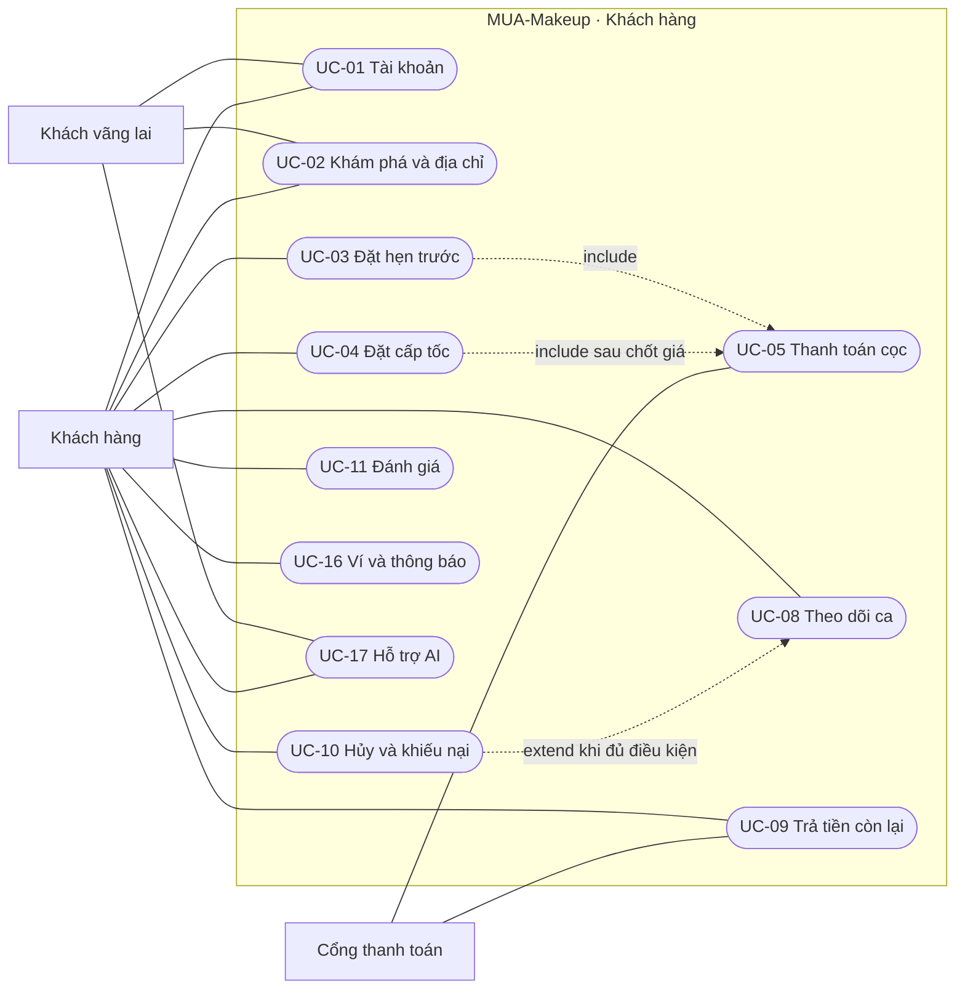

### 12.3. Use case nhà cung cấp

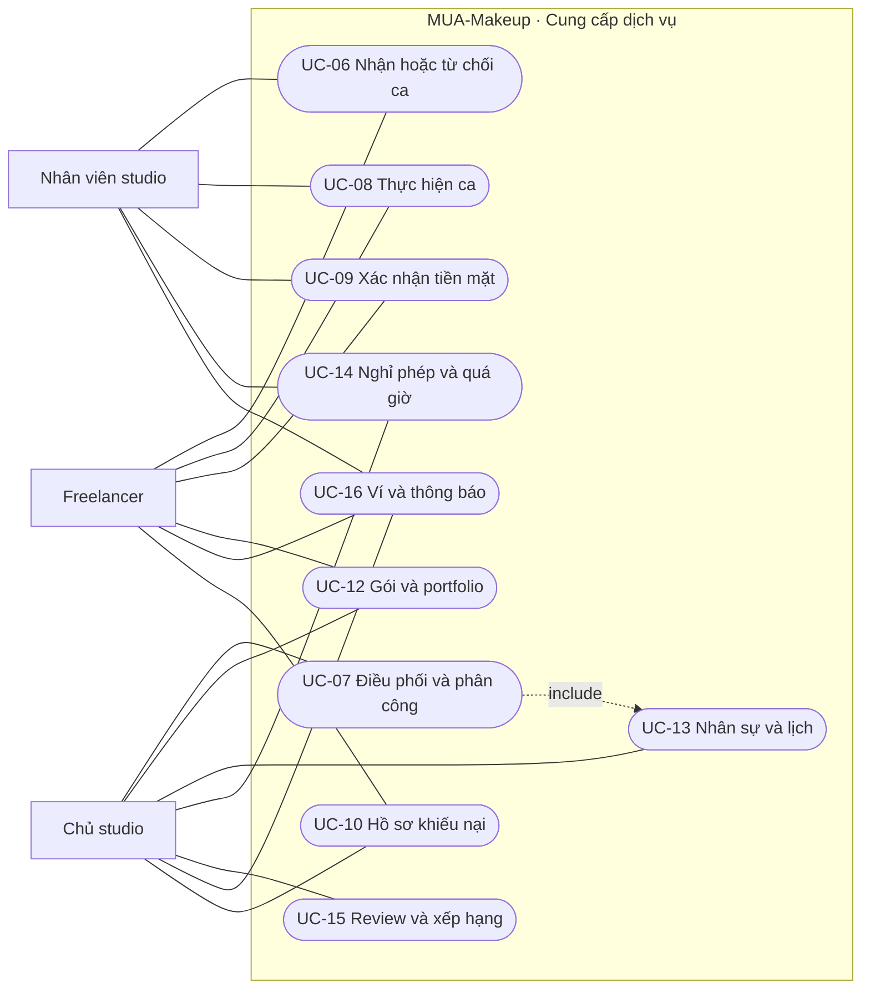

### 12.4. Use case quản trị và tích hợp

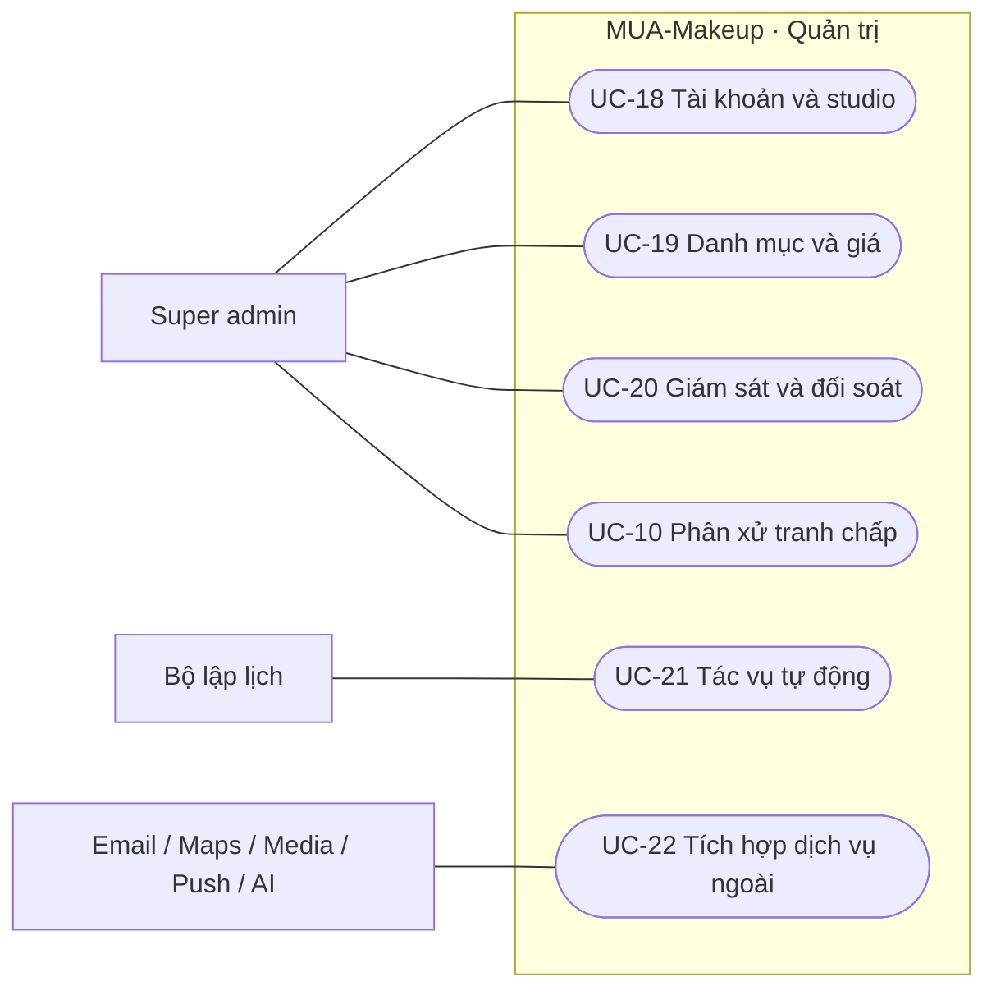

### 12.5. Đặc tả các ca sử dụng

Các bước ngăn cách bằng “→” là thứ tự luồng chính. Mọi ca ghi dữ liệu phải kiểm tra đầu vào/quyền ở server; lỗi không được báo thành công trên client. Hậu điều kiện chỉ áp dụng khi thành công. Các UC có ưu tiên **P1** (phạm vi sản phẩm hiện tại); đúng tiền, phân quyền và chống trùng là điều kiện chặn phát hành.

| UC / yêu cầu | Tác nhân, kích hoạt và tiền điều kiện | Luồng chính | Ngoại lệ và hậu điều kiện |
| --- | --- | --- | --- |
| UC-01 · AUTH | Người dùng mở đăng ký/login; thông tin hợp lệ | Gửi thông tin → kiểm tra → OTP nếu admin → cấp/khôi phục phiên | Trùng tài khoản, sai/hết OTP, bị khóa: từ chối; thành công có phiên đúng quyền. Refresh/logout theo token. |
| UC-02 · DISC, ADDR | Guest/khách tìm dịch vụ | Chọn vị trí → tìm/lọc → xem hồ sơ/gói/review → chọn địa chỉ | GPS bị từ chối: chọn thủ công; kết quả trống phải rõ; địa chỉ riêng chỉ lưu cho chủ. |
| UC-03 · BOOK-SCH, PRICE | Khách có gói, thời gian, địa chỉ hợp lệ | Preview → kiểm tra khả dụng → tạo đơn và snapshot → trả cọc/deadline | Slot/gói sai: từ chối; thành công PENDING_DEPOSIT, chưa độc quyền giữ slot. |
| UC-04 · BOOK-INS | Khách đặt gấp tại vị trí hợp lệ | Tạo yêu cầu → tìm ứng viên → offer → thợ nhận → khách chốt giá | Hết TTL/không thợ/từ chối provider: dọn offer; chỉ một nhận ca hợp lệ. |
| UC-05 · PAY-01..03 | Khách có đơn chưa đủ cọc | Checkout → gateway → xác minh IPN/sync → kiểm tra lại slot → ghi cọc | Chữ ký/số tiền sai: không ghi tiền; callback lặp: không ghi đôi; SLOT_TAKEN theo service. |
| UC-06 · BOOK | Freelancer/staff có offer hoặc assignment hợp lệ | Xem → nhận/từ chối → kiểm tra deadline/quyền/lịch → cập nhật | Hết hạn, đã được nhận, sai assignment: từ chối; trạng thái và lịch đồng bộ. |
| UC-07 · AG-08..10 | Chủ studio có đơn chờ phân công | Xem ma trận → chọn chính/phụ → gán → xác nhận → điều phối lại nếu cần | Staff sai studio/bận/thiếu kỹ năng: chặn; lưu assignment và thông báo. |
| UC-08 · JOB | Thợ chính có ca hợp lệ, đủ cọc | Khởi hành → GPS → đến nơi → làm → ảnh → hoàn thành | Thiếu ảnh/cọc/sai trạng thái: chặn; thợ phụ không tự đổi tiến độ; reconnect đọc server. |
| UC-09 · PAY-04..06, FIN | Đơn đủ điều kiện trả phần còn lại | Online: intent → callback/sync; cash: khách và thợ xác nhận → settlement | Một phía chưa đủ; DISPUTED không tự chi; retry không cộng lại; dùng kết quả backend. |
| UC-10 · DISPUTE | Bên liên quan gửi hủy/khiếu nại; người xử lý có quyền | Kiểm tra giai đoạn → lý do/ảnh → đối chất → quyết định → tiền/lịch/audit | Không tự hủy vượt quyền; thiếu bằng chứng/số dư cần đối soát; resolve không chi trùng. |
| UC-11 · REV-01..05 | Khách mở đơn mình hoàn thành/quyết toán trong hạn | Nhập điểm/ảnh → gửi → APPROVED → cập nhật tổng hợp; sửa trong hạn | Trùng booking/hết hạn/sai chủ/đã xóa: chặn; sửa không tạo bản ghi mới. |
| UC-12 · CAT | Freelancer/chủ studio quản lý catalog của mình | Tạo gói/item/showcase → validate → lưu → bật/tắt/ẩn/nổi bật | Sai owner/gói: chặn; thay catalog không tự sửa snapshot booking. |
| UC-13 · AG-03..06,18 | Studio mời/duyệt staff hoặc xếp ca | Mời → gia nhập → duyệt → gán kỹ năng/gói → xếp ca | Mời hết hạn/thu hồi, trùng lịch: chặn; staff active/lịch là căn cứ dispatch. |
| UC-14 · AG-11..12, FIN-06 | Staff gửi nghỉ/quá giờ; studio duyệt | Tạo → xem → duyệt/từ chối → cập nhật lịch/report; thưởng thử chi khi đủ tiền | Sai chủ/đã xử lý: chặn; thiếu tiền PENDING_FUNDS, không chi một phần; lệch ledger cần đối soát. |
| UC-15 · REV-06..09 | Studio mở review/leaderboard | Lọc kỳ/staff/điểm → tổng hợp → xem/reply | Không review: null; <5 review: không hạng chất lượng; studio không đếm đôi review. |
| UC-16 · WALLET, NOTI | Người dùng đăng nhập mở ví/thông báo | Tải → lọc/chi tiết; đọc/xóa notification → mở đơn | Sai chủ: chặn; reconnect tải lại; xem ví không phải rút ngân hàng. |
| UC-17 · AI | Guest/người dùng gửi câu hỏi/mở session | Kiểm tra session → retrieval/ngữ cảnh → model → lưu/hiển thị → đóng | Sai chủ: chặn; model lỗi: báo lỗi; trả lời không tự đặt/hủy/thanh toán. |
| UC-18 · ADM-02..04 | Super admin mở user/studio/chứng chỉ | Lọc/xem → tạo/đổi trạng thái/thẩm định → lưu | Sai role/dữ liệu sai: chặn; thay trạng thái theo chính sách server. |
| UC-19 · ADM-05..06,09 | Super admin chỉnh danh mục/giá/phí | Xem → sửa → kiểm tra phạm vi/tỷ lệ → lưu | Tỷ lệ ngoài [0,1]: chặn; không tự viết lại ledger lịch sử. |
| UC-20 · ADM-01,07,09 | Admin giám sát/đối soát phí | Xem booking → preview đối soát → ghi nếu hợp lệ | Snapshot đổi/đã hoàn/thiếu tiền: chặn; lặp không trừ tiếp; GET không ghi. |
| UC-21 · NOTI-05, BOOK | Scheduler tới kỳ | Quét deadline → kiểm tra → hết hạn/nhắc → dọn lease/lịch | Chạy lại không ghi/gửi trùng; không hết hạn đơn đã chuyển hợp lệ. |
| UC-22 · PAY, PRICE, CAT, AI | Backend cần dịch vụ ngoài | Request hợp lệ → adapter → kiểm tra kết quả → cập nhật | Timeout không giả thành công; callback xác thực; secret chỉ ở server. |

## 13. Sơ đồ kiến trúc, hoạt động và sequence

Sơ đồ mô tả cộng tác ở mức nghiệp vụ. Participant Backend có thể gồm nhiều service trong monolith; mỗi ô không phải một microservice hoặc transaction riêng. Nhánh ngoại lệ thể hiện bằng alt/opt hoặc trong UC tương ứng.

### 13.1. Kiến trúc và ranh giới hệ thống

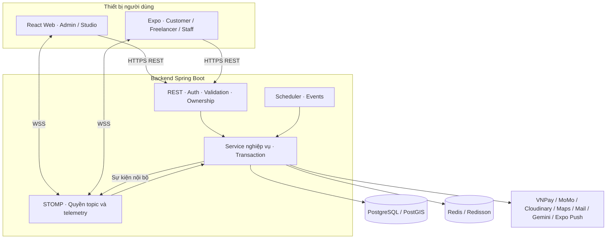

Compose cung cấp PostgreSQL và Redis; client/backend chạy riêng. HTTPS/WSS là yêu cầu triển khai, không khẳng định môi trường phát triển đã bật TLS. Simple broker/event nội bộ chưa phải bus bền vững giữa nhiều backend.

### 13.2. Activity — vòng đời dịch vụ

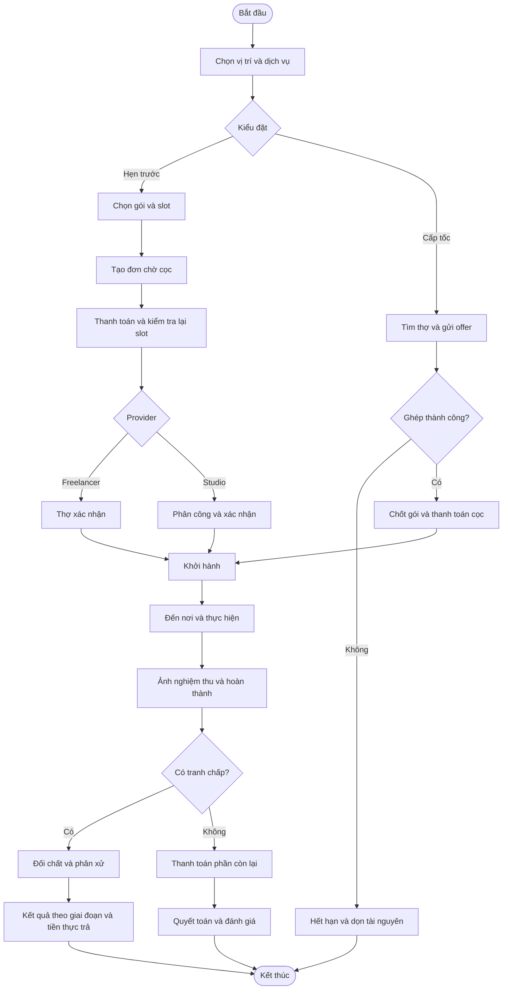

Nhánh hủy/từ chối/hết hạn ở từng bước tuân theo mục 4; hình không mở thêm quyền hủy hoặc quyền chi tiền. Khiếu nại còn có thể phát sinh ở các giai đoạn khác theo state machine.

### 13.3. SQ-01 — Đăng nhập và OTP quản trị

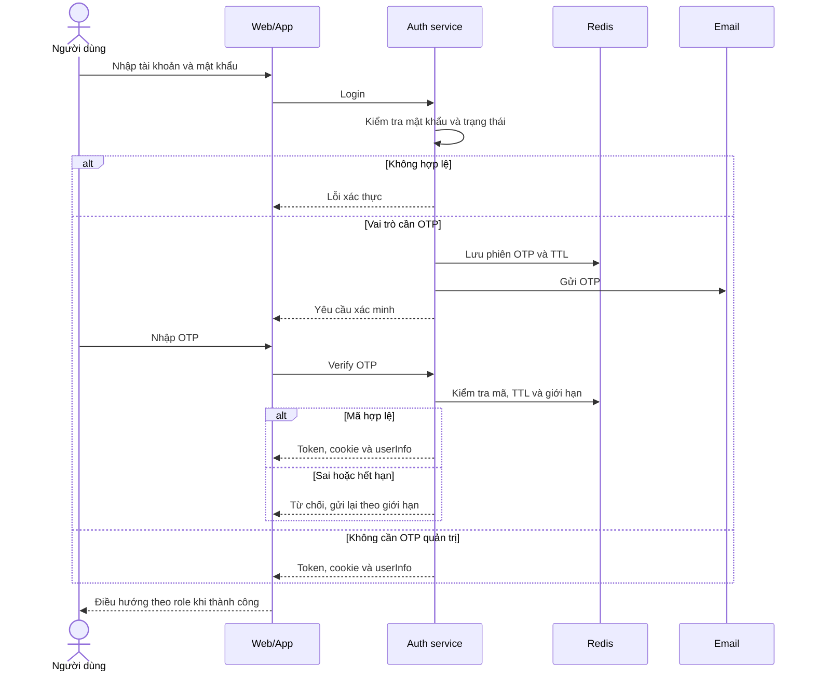

### 13.4. SQ-02 — Đặt hẹn và thanh toán cọc

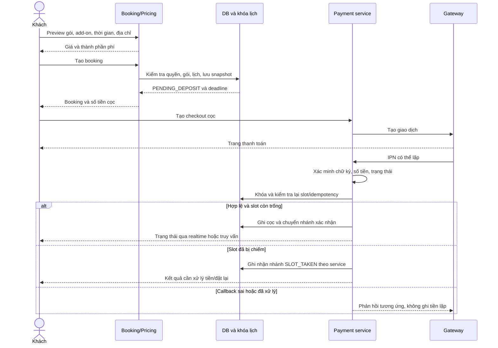

### 13.5. SQ-03 — Ghép thợ cấp tốc

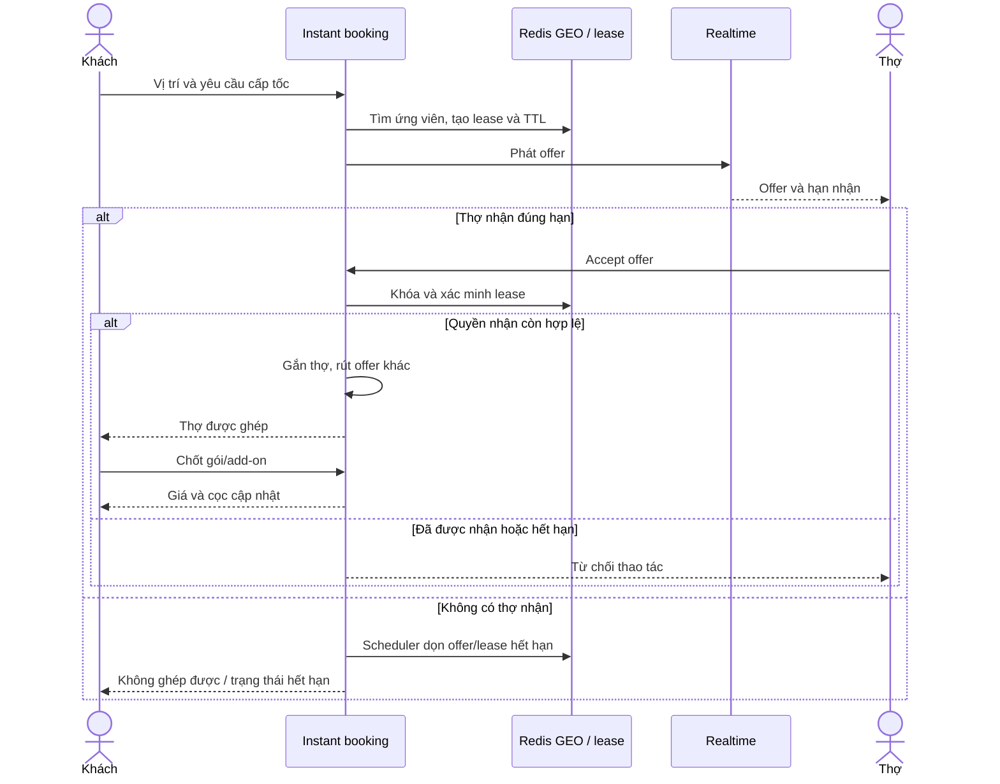

### 13.6. SQ-04 — Studio phân công nhân viên

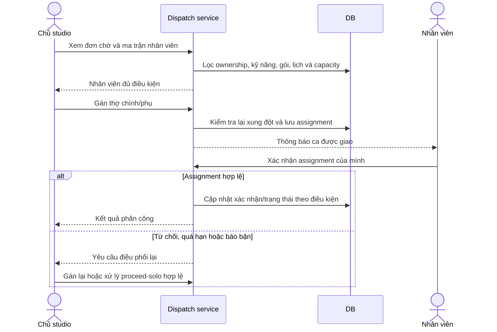

### 13.7. SQ-05 — Thực hiện ca và vị trí

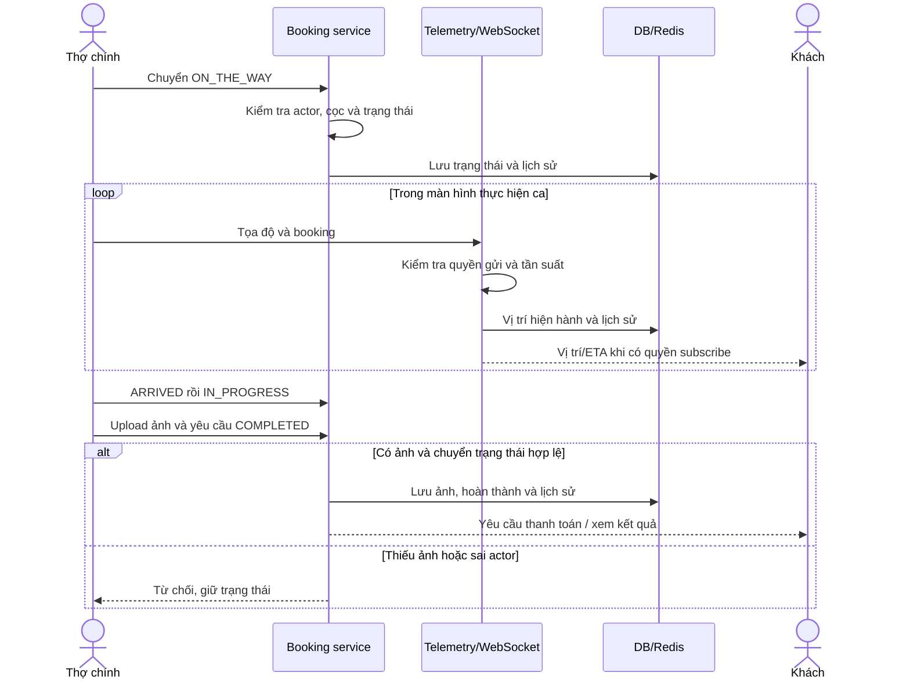

### 13.8. SQ-06 — Tiền mặt và quyết toán

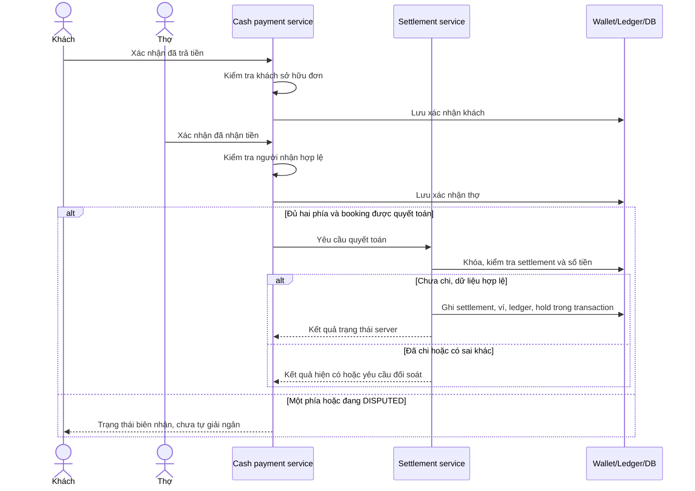

### 13.9. SQ-07 — Thanh toán online phần còn lại

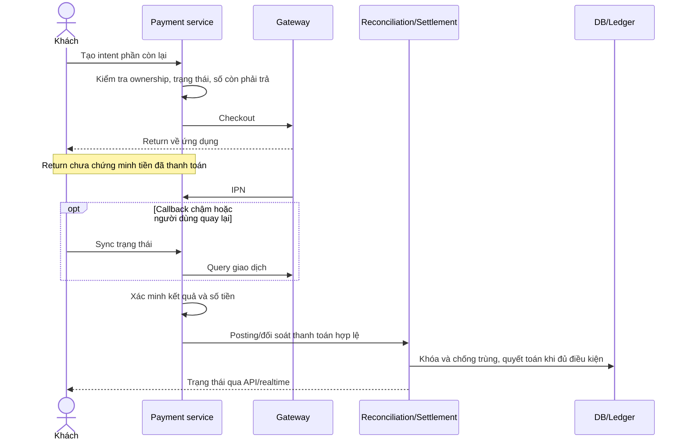

### 13.10. SQ-08 — Khiếu nại và giải quyết

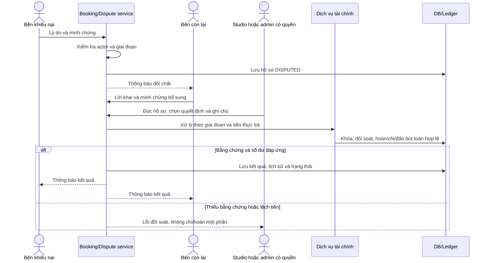

### 13.11. SQ-09 — Đánh giá và bảng xếp hạng

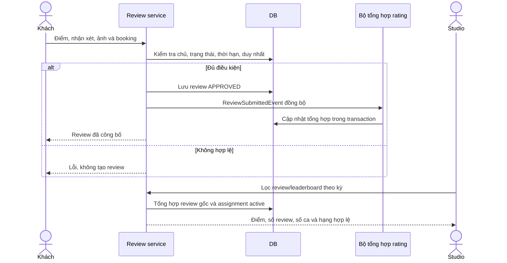

### 13.12. SQ-10 — Duyệt thưởng quá giờ

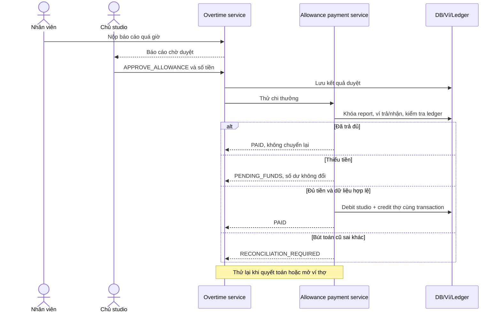

### 13.13. SQ-11 — Hỗ trợ AI và quyền phiên

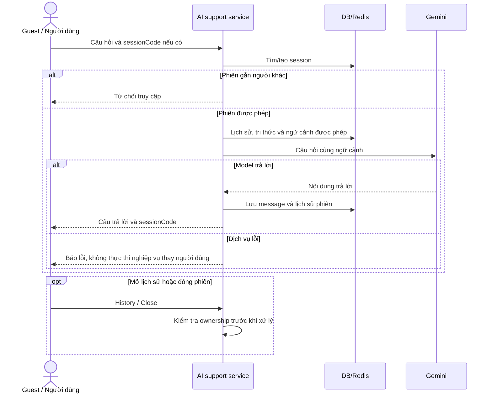

## 14. Mô hình dữ liệu và ERD

### 14.1. Quy ước đọc

ERD là mô hình logic rút gọn từ entity/migration: `||` là một, `o|` không hoặc một, `o{` không hoặc nhiều. PK/FK chỉ thể hiện các khóa cần đọc luồng, không phải DDL đầy đủ. Quan hệ provider optional phản ánh đơn có thể chưa ghép thợ/gói. Bảng vật lý và nguồn ở phụ lục 16.3; audit kế thừa không lặp ở mọi hình.

### 14.2. ERD-01 — Tài khoản, studio và catalog

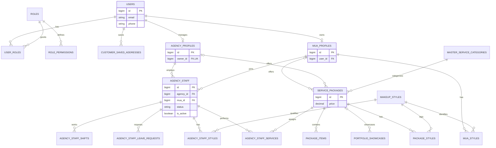

Mỗi gói thuộc loại provider tương ứng; hình không cho phép suy diễn gói luôn đồng thời thuộc freelancer và studio. Portfolio có thể phục vụ gallery studio; quan hệ gói có thể vắng mặt theo entity.

### 14.3. ERD-02 — Booking và vận hành

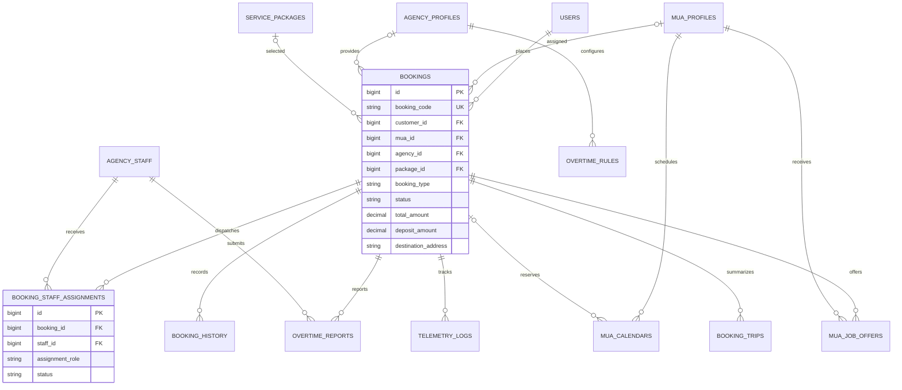

OVERTIME_REPORTS/RULES là nhãn rút gọn cho bảng báo cáo/quy tắc quá giờ trong agency_schema. Quan hệ telemetry/trip biểu diễn liên kết nghiệp vụ, không khẳng định mọi liên kết có FK vật lý. Calendar có thể là lịch bận không gắn booking. Snapshot giá/add-on và dispute nằm trên booking/entity liên quan, không phát minh bảng dispute riêng.

### 14.4. ERD-03 — Tài chính và tương tác

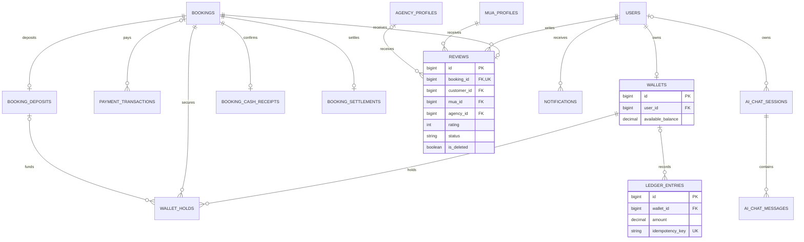

Ví studio truy cập qua chủ studio, không mặc định có bảng agency_wallets riêng. Tri thức AI phục vụ retrieval, không phải FK bắt buộc của từng message. Payment, cọc, hold và settlement là các bản ghi có trách nhiệm riêng.

### 14.5. Từ điển dữ liệu nghiệp vụ

| Nhóm | Quy tắc / cách sử dụng |
| --- | --- |
| Định danh | User/MUA/staff/agency/booking ID là các miền khác nhau. Mã booking/payment/session không thay thế ownership. |
| Tiền | Decimal/BigDecimal; phí làm tròn theo service; lưu tổng/cọc/snapshot; không tin giá client tự gửi. |
| Ngày giờ | Phân biệt ngày hẹn với timestamp; deadline từ server; test ranh giới UTC+7, 2h, 7 ngày và 48h. |
| Tọa độ | Latitude/longitude đúng miền và thứ tự; công khai có thể làm mờ; lịch sử chỉ cho bên có quyền. |
| Media | Kiểm loại/kích thước/quyền upload; lưu URL/metadata; không đưa secret Cloudinary vào client. |
| Trạng thái | Booking, assignment, payment, review, overtime là các vòng đời riêng; duyệt report chưa chứng minh trả tiền. |
| Review | Một review/booking; kiểm chủ và hạn; sửa không khôi phục bản đã xóa; chưa review thì điểm tổng hợp có thể null. |
| Audit/snapshot | Lưu giá, actor, trạng thái, lý do; thay cấu hình không tự xóa bút toán cũ. |
| Redis | Token/OTP/lease/GEO/cache/cấu hình phí; TTL và mất Redis có tác động khác nhau; không thay ledger. |
| Riêng tư | Mật khẩu băm; quyền đọc token/địa chỉ/GPS/chứng cứ phù hợp; log tránh dữ liệu nhạy cảm không cần thiết. |

### 14.6. Toàn vẹn, lưu giữ và khôi phục

- **DATA-01:** Không tạo review trùng booking, ledger/settlement trùng nghiệp vụ hoặc assignment trái quyền; kiểm chứng ràng buộc và khóa bằng test đồng thời.
- **DATA-02:** Số dư và ledger cập nhật nguyên tử; lỗi ghi sổ không để số dư đã đổi; callback trễ không ghi đè vô điều kiện trạng thái mới.
- **DATA-03:** Migration Flyway là nguồn thay đổi schema; kiểm thử nâng cấp trên bản sao và đối soát tổng tiền trước phát hành.
- **DATA-04:** Không xóa tùy tiện tài chính/audit theo thao tác UI; thời hạn lưu GPS/ảnh/AI/audit và quy trình xóa dữ liệu cá nhân chưa được chốt, cần chính sách trước production.
- **DATA-05:** Có sao lưu và diễn tập restore; RPO/RTO ở mục 15 là đề xuất, chưa phải năng lực được chứng minh.

## 15. Giao diện ngoài, chất lượng và nghiệm thu

### 15.1. Hợp đồng giao diện ngoài

| Giao diện | Dữ liệu / trách nhiệm | Xử lý lỗi và an toàn |
| --- | --- | --- |
| REST `/api/v1` | JSON, ApiResponse, DTO validation; phân trang từng endpoint; multipart media | Phân biệt xác thực/phân quyền/validation/not-found/conflict; không lộ stack trace. |
| WebSocket `/ws-makeup` | STOMP thường/SockJS, `/app`, `/topic`, `/queue` | JWT CONNECT, quyền destination; reconnect đọc REST; event không phải sổ cái bền vững. |
| VNPay / MoMo | Checkout, IPN, return, query/sync | Xác minh chữ ký/số tiền; duplicate/timeout/out-of-order không ghi tiền hai lần. |
| Maps | Autocomplete, geocode/reverse, place, khoảng cách/ETA | GPS tắt cho chọn thủ công; ETA là ước lượng; fallback cần nhận biết. |
| Cloudinary | Avatar, chứng chỉ, showcase, ảnh hoàn thành/chứng cứ/review | Kiểm upload/quyền; upload lỗi không hoàn thành ca cần ảnh. |
| Email / Expo Push | OTP và thông báo | TTL/gửi lại giới hạn; push không thay dữ liệu DB/quyền đọc deep link. |
| Gemini | Trả lời/embedding và tri thức | Không dùng câu trả lời làm lệnh giao dịch; lỗi dịch vụ phải rõ. |

### 15.2. Chỉ tiêu phi chức năng có thể kiểm thử

Ngưỡng số dưới đây là **đề xuất làm mốc nghiệm thu**, chưa được chủ dự án phê duyệt hoặc benchmark. Đúng quyền và đúng tiền là bắt buộc, không giảm vì tốc độ.

| ID | Tiêu chí chấp nhận | Cách đo / phạm vi |
| --- | --- | --- |
| Q-01 | 100% ca âm quyền trong bộ kiểm thử bị chặn, không lộ payload riêng | Guest, sai role/studio/booking, token hết hạn, SUBSCRIBE/SEND trái quyền. |
| Q-02 | 20 request nhận cùng offer: tối đa một người thắng | Đồng thời; kiểm DB/lịch/lease và thông báo. |
| Q-03 | Replay callback/settlement 20 lần chỉ thay đổi tiền một lần | Đối chiếu payment/hold/ledger/settlement/số dư; IPN cùng sync. |
| Q-04 | REST đọc nội bộ p95 ≤2 giây, lỗi hệ thống <1% | Đề xuất 50 người dùng đồng thời, 15 phút; không tính gateway/AI; ghi máy/dữ liệu/mạng. |
| Q-05 | Trạng thái tới client đang kết nối p95 ≤3 giây | Từ commit tới event; reconnect phải phục hồi bằng REST. |
| Q-06 | Từ chối GPS/camera/push không crash, có hướng dẫn | iOS/Android/Expo Web; mất mạng, foreground, phiên hết hạn. |
| Q-07 | Form có label, lỗi gần trường, loading/empty/error; web dùng bàn phím | Auth/booking/payment/admin; chưa tuyên bố chứng nhận accessibility. |
| Q-08 | Không secret trong tài liệu/client; không log token/OTP | Rà cấu hình build, log mẫu, lỗi tích hợp. |
| Q-09 | Đề xuất RPO ≤24h, RTO ≤4h | Restore DB môi trường riêng, đối soát tổng tiền; chưa đo thực tế. |
| Q-10 | Giờ/giá/cọc/phí thống nhất API/UI/ledger | Deadline, thay phí, đơn cũ, cash/online và loại provider. |
| Q-11 | Lỗi giữa debit/credit rollback toàn transaction | Tiêm lỗi ghi ledger, kiểm hai ví và trạng thái. |
| Q-12 | Không tuyên bố sẵn sàng nhiều backend khi chưa có event chung | Test tách instance REST/WS/scheduler; simple broker là giới hạn. |

### 15.3. Ma trận truy vết và nghiệm thu

Tên test/source là điểm truy vết, không phải kết quả chạy. Khi thực thi phải lưu môi trường, đầu vào, mong đợi/thực tế và minh chứng DB/API/UI.

| AC | Yêu cầu → UC → sơ đồ | Kịch bản / mong đợi | Nguồn kiểm tra |
| --- | --- | --- | --- |
| AC-01 | AUTH → UC-01 → SQ-01 | Login/OTP sai/hết hạn, logout/refresh; không vào sai role | AuthServiceTest, LoginOtpTest, RedisTokenServiceTest |
| AC-02 | CAT, PRICE, ADDR → UC-02/12/19 | Gói ẩn/sai owner, item sai gói, địa chỉ người khác: chặn | ServicePackageServiceImplTest, PackageItemServiceTest, CustomerAddressServiceTest |
| AC-03 | BOOK-SCH, PAY → UC-03/05 → SQ-02 | Cùng slot, kiểm lại khi cọc; không nhận trùng; xử lý SLOT_TAKEN | CustomerScheduledBookingServiceImpl, PaymentWebhookLifecycleTest |
| AC-04 | BOOK-INS → UC-04/06 → SQ-03 | Offer hết TTL/nhận đồng thời; một người thắng, dọn lease | FreelancerBookingServiceTest, DistributedLockServiceTest |
| AC-05 | AG-08..10 → UC-07 → SQ-04 | Staff sai studio/bận/không kỹ năng và phụ tự đổi trạng thái bị chặn | AgencyStaffCapacityServiceTest, AgencyBusyAssignmentTest, BookingStateAuthorizationTest |
| AC-06 | JOB → UC-08 → SQ-05 | Chưa cọc/thiếu ảnh/sai actor: chặn; GPS đúng quyền | BookingStateAuthorizationTest, WebSocketTelemetryHandlerTest |
| AC-07 | PAY-05..06 → UC-09 → SQ-06 | Cash một phía chưa quyết toán; DISPUTED không tự đóng | CashPaymentAuthorizationTest, FinalPaymentSettlementTest |
| AC-08 | PAY-03..04 → UC-05/09 → SQ-02/07 | IPN sai chữ ký/tiền; callback/sync lặp; return không giả thành công | GatewaySecurityTest, PaymentWebhookAmountTest, FinalPaymentPostingTest |
| AC-09 | DISPUTE → UC-10 → SQ-08 | Hoàn/chi đúng giai đoạn, không trùng, thiếu tiền không ghi một phần | DisputeStageServiceTest, StudioDisputeFinanceTest, AdminDisputeServiceTest |
| AC-10 | REV → UC-11/15 → SQ-09 | Công bố ngay; sửa không tăng count; thợ phụ ghi nhận, studio không đếm đôi | AutomaticReviewPublicationTest, AgencyStaffLeaderboardServiceTest, AgencyStaffLeaderboardQueryTest |
| AC-11 | AG-11..12, FIN-06 → UC-14 → SQ-10 | Nghỉ trái quyền bị chặn; thưởng thiếu tiền giữ nguyên ví, đủ tiền chi một lần | AgencyLeaveRequestServiceImpl, OvertimeAllowancePaymentTest |
| AC-12 | FIN-01..05 → UC-19/20 | Phí hợp lệ; preview không ghi; đối soát kiểm snapshot và không trừ lặp | PlatformFeeService, StudioFeeReconciliationTest |
| AC-13 | AI → UC-17 → SQ-11 | Sai chủ session chặn; model lỗi rõ; đồng bộ prompt hủy trước nghiệm thu | AiSupportServiceImpl, KnowledgeRetrievalServiceTest |
| AC-14 | NOTI, Q-01/05 → UC-16/21 | Đọc/xóa/deep link đúng chủ; token thu hồi không đọc topic riêng | NotificationDeliveryTest, WebSocketSecurityInterceptorTest, WebSocketAccessServiceTest |
| AC-15 | DATA, Q-09/11 → UC-09/14/20 | Restore/rollback giữ tổng tiền/audit, không nửa bút toán | PostgresRepositoryTest và diễn tập vận hành bổ sung |
